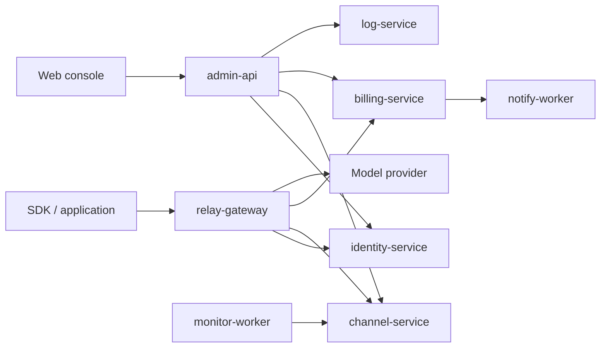

# micro-one-api

[简体中文](./README.md) | [English](./README.en.md)


`micro-one-api` is a self-hosted AI API gateway and management system built with
Go Kratos. It brings multiple upstream providers, access tokens, wallets,
subscriptions, billing and an operations console into one platform, with
separate services for each responsibility.

The project draws on [one-api](https://github.com/songquanpeng/one-api) for
multi-channel API distribution and [sub2api](https://github.com/Wei-Shaw/sub2api)
for subscription windows, account pools, rate limits and usage management.
You provide your own authorized upstream accounts and API keys.

> Latest release: [v0.36.2](./docs/releases/release-v0.36.2.md) — timing SQL capacity,
> pagination fixes and Q3 startup recovery.
> [GitHub Release](https://github.com/mengbin92/micro-one-api/releases/tag/v0.36.2)

## Features

- OpenAI-compatible `/v1/chat/completions`, `/v1/models`, `/v1/responses` and raw
  relay routes for embeddings, audio, images and moderations.
- Multiple upstream channels with priorities, weights, model allowlists and
  mappings; provider adapters include Anthropic, Gemini, Azure and VoyageAI.
- Users, API tokens, model permissions and role-based administration.
- Wallet reservations and settlement, ledgers, redemption codes, payment orders,
  subscription purchases, renewals and refunds.
- Subscription account pools, quota windows, recovery probes and quota alerts,
  including integrations for GLM, MiniMax and Kimi.
- Usage, upstream costs, revenue and gross-profit reporting, plus reconciliation.
- A React/Vite console with Chinese and English interfaces.
- Health checks, Prometheus metrics, logs, request timing and Jaeger trace views.
- SQLite Lite, MySQL and PostgreSQL deployment configurations, plus Kubernetes manifests.

Individual provider capabilities depend on the adapter and upstream API. Request
timing separates observed stages, incomplete traces and unknown values; it does
not measure the provider's internal inference time or the client's receive time.

## Screenshots

These screenshots use test accounts or redacted data. They show the Chinese UI;
the console also has a language switch.

| User dashboard | API tokens |
|:---:|:---:|
|  |  |
| Channel health | Cost analysis |
|  |  |

The [Lite walkthrough](./docs/assets/demos/lite-quickstart.mp4) demonstrates login,
channel creation, token creation and the Playground using isolated test data and a local mock upstream.

## Who it is for

- Teams that need one self-hosted entry point for multiple model providers.
- Internal platforms and SaaS teams that need users, wallets, subscriptions and auditable billing.
- Operators comfortable maintaining Redis and a multi-service deployment.

SQLite Lite supports single-host, low-concurrency use. It still runs nine
application services and Redis. A single-binary deployment is not provided.

## Architecture



`config-service` manages dynamic configuration. Domain libraries live in
`domain/`, shared infrastructure in `platform/`, service implementations in
`app/`, and the Relay entry point in `cmd/relay-gateway/`.

## Quickstart

Follow the **[English SQLite Lite Quickstart](./docs/quickstart-lite.en.md)** for
the complete setup: generate keys, start services, retrieve the initial admin
password, create a channel, fund a wallet, create a token and send a request.

Prerequisites are Git, Docker with Compose, and Python 3. Initial source builds
need at least 4 CPUs, 8 GiB RAM and 20 GiB free disk allocated to Docker; build
time is separate from setup time. SQLite Lite is intended for one host.

Default endpoints:

| Endpoint | Address |
|---|---|
| Console | `http://127.0.0.1:3000` |
| Relay API | `http://127.0.0.1:8080` |
| Health | `http://127.0.0.1:8080/healthz` |

For MySQL, PostgreSQL and production operations, see the
[deployment guide](./docs/deployment.md) (Chinese).

## API example

After completing the Quickstart, set `API_TOKEN` to your Relay token and `MODEL`
to a model configured on your channel. The upstream provider key belongs in the
channel configuration, not in the client request.

```bash
curl --fail-with-body http://127.0.0.1:8080/v1/models \
  -H "Authorization: Bearer ${API_TOKEN}"

curl --fail-with-body http://127.0.0.1:8080/v1/chat/completions \
  -H "Authorization: Bearer ${API_TOKEN}" \
  -H 'Content-Type: application/json' \
  --data "{\"model\":\"${MODEL}\",\"messages\":[{\"role\":\"user\",\"content\":\"Hello\"}],\"max_tokens\":16,\"stream\":false}"
```

Use `"stream":true` and `curl -N` for SSE. Successful model requests consume
upstream quota and may debit the local wallet according to the configured policy.

## Development and tests

The repository pins Go in `go.mod`; the Web toolchain requires Node.js 24.

```bash
make init proto       # Prepare generation tools and generated sources
make build
make run-all          # Core identity/channel/relay development services
make web-dist
make test             # Unit tests and integration tests without external services
make test-health      # Check that selected tests detect deliberate regressions
make test-e2e         # Docker Compose end-to-end tests
```

See the [testing self-check guide](./docs/runbooks/test-health-self-check.md)
and [repository development rules](./AGENTS.md). Both are currently maintained in Chinese or their original language.

## Releases and upgrades

- [v0.36.2](./docs/releases/release-v0.36.2.md): grouped timing writes, pagination
  fixes, Q3 startup recovery and native builds. Adds Log index migration 139;
  upgrade Log before Relay and preserve the production observation window.
- [v0.36.1](./docs/releases/release-v0.36.1.md): ordinary WS sessions, Lite startup
  and timing-alert fixes, with native performance and empty-volume recovery checks.
  No new migrations; the production observation window continues unchanged.
- [v0.36.0](./docs/releases/release-v0.36.0.md): request timing, trace waterfalls,
  ledger links and completeness checks. Adds Log migration 137 and Billing migration 138.
- [v0.35.2](./docs/releases/release-v0.35.2.md): atomic pricing updates,
  concurrency checks and authorization-bound drafts.

Read the target release's migration and rollback steps before upgrading.
Production Compose serves the frontend from a separate host mount; rebuilding
the Admin image does not update it. Lite includes the frontend in the Admin image.

The [changelog](./CHANGELOG.md), [release notes](./docs/README.md#releases--版本发布公告),
advanced deployment guides and internal design/runbooks are currently in Chinese.

## Security and license

Replace deployment secrets, protect upstream credentials and backups, configure
HTTPS and access controls for public deployments, and use providers according to
their terms and your authorization. The project supplies no model accounts,
subscriptions or API keys. See the full [disclaimer](./DISCLAIMER.md) (Chinese).

Licensed under the [MIT License](./LICENSE). Built on
[Go Kratos](https://github.com/go-kratos/kratos).
