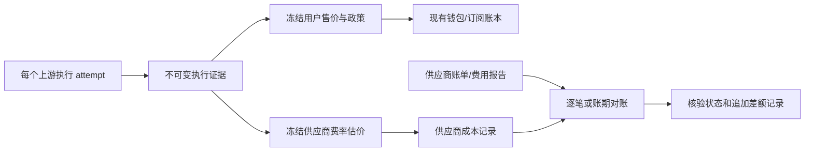

# 计费准确性与上游成本证据方案

实现复审（2026-10-15）：补齐原生状态/流终结、持久送达容量与重试、不可变对账顺序及 unknown 更正、运营判定等边界；同时收紧契约与探测门禁。源码修复与现场关卡分别记录，见[实现复审与回归证据](../runbooks/billing-upstream-review-2026-10-15.md)。后续生产更新已随下述管理页面发布完成，真实供应商账期与收费门禁仍分别验收。

管理页面与运营入口更新（2026-10-15 开始，2026-10-16 已发布）：补齐“供应商核验” `/admin/vendor-reports` 与“上游契约” `/admin/upstream-contracts` 页面和菜单，修复 owner gRPC ready 方法漏登记导致读取返回 403 的问题。本轮仅为 root 启用并绑定 `billing.vendor_report.read`、`channel.upstream_contract.read` 两项读取权限；报告导入/归因、契约创建和状态变更仍受各自独立授权与门禁约束，真实调用及收费开关保持原值。版本、迁移、前端和实际访问验证见[管理页面生产更新记录](../runbooks/evidence-management-pages-deploy-2026-10-16.md)。

日期：2026-10-13。代码基线：`91e5686f`。阶段接续：按本轮指令以 P0/P1/P2 已完成为基线，继续 P3。历史交付与现场边界保留于各阶段记录，新来源收费与新窗口门禁仍分别核对。

P3 工程接续（2026-10-14）：已接通受限 OpenAI/Anthropic 费用 API、原始分页归档与独立 CSV owner 核验、迟到/更正链、周复盘/资金证据告警，以及带独立回放和 reviewer 签名的候选修复接缝。新代码 patch 保持待审和 CI/新制品边界，发布复用 P2 的预算/canary/灰度/回滚。见 [P3 工程与验收边界](../runbooks/billing-upstream-p3-2026-10-14.md)。

DeepSeek 官方试点（2026-10-14）：已完成 deepseek-flash 六次真实推理，覆盖 JSON/SSE/tool/缓存与扩大输入样本。原生响应与官方导出均为 140,333 token，按原币估价和实际费用导出均为 0.14036956 CNY；本轮余额扣减 0.14 CNY 与分位精度相符。费用快照已核对，完整日账期尚未关闭，候选仍未注册收费。见 [扩大余额核验与渠道 1 诊断](../runbooks/deepseek-balance-and-channel1-2026-10-14.md)；首次四次证据保留于 [初次试点](../runbooks/deepseek-official-pilot-2026-10-14.md)。

P2 后续工程进展（2026-10-14）：typed contract/不可变版本/CAS、有限规则与快照执行、持久协议事故/TTL 验证、受控 canary proof、灰度/回滚及报告 IAM/API/日报覆盖已接通。见 [P2 工程交付与现场边界](../runbooks/billing-upstream-p2-completion-2026-10-14.md)。P2.1 的 amd64 工具制品缺口已用本地 buildx/CGO 补齐；真实账期/生产窗口仍独立待验，未部署或扩大收费。

P2.1 工程进展（2026-10-13）：固定账号/账期 CSV、原币 decimal、attempt 采购去重、内部费用分离、不可变报告/更正链及归因回放已实现。见 [P2.1 外部核验交付与边界](../runbooks/billing-upstream-p2-external-2026-10-13.md)。未部署生产、未用合成 fixture 代替真实费用证据；typed contract/CAS/规则与事故恢复仍属 P2 后续工程。

P1 工程进展（2026-10-13）：按 Neo 指令完成后续全部工程功能，包含 relay WAL 发件箱、原子 intent/lease/期限、原生 usage v2 与独立采购证据、库存/canary/预算一次性许可和 L2 报告。见 [P1 工程交付与验收](../runbooks/billing-upstream-p1-completion-2026-10-13.md)。已部署 `ea8078d4` 的 linux/amd64 镜像并开启 P1 开关，见 [P1 生产部署记录](../runbooks/billing-upstream-p1-deploy-2026-10-13.md)。工程及上线验证不代替 P0 生产窗口、独立供应商核验与收费灰度门禁。

历史实施记录（P0 部署时，2026-10-13）：P0 实现提交 `0fe3436f` 已部署到线上 relay，并开启脱敏原生 usage 影子观测；生产窗口和独立费用证据尚未验收；P1 工程开关已按后续部署指令开启，收费名单仍独立受控。见 [P0 基线与验收边界](../runbooks/billing-upstream-p0-baseline-2026-10-13.md)。

配套：[上游接口变更适应方案](upstream-contract-evolution-plan-2026-10-13.md)。本方案保留现有扣费引擎，补齐执行证据、可靠送达和外部成本核验。

本次优化参考 下载的计费方案（原稿路径：`/Users/neo/Downloads/micro-one-api 计费准确性保障技术方案.md`）（2026-10-13，@Neo）。下载稿的版本记录用于提出问题，当前行为以下述源码为准；未读取生产开关、真实供应商账单或账户权限。建议字段、表和政策均为待实施设计，不能据本文宣称已上线。

| 下载稿建议 | 处理 | 本方案落点 |
|---|---|---|
| 用户售价与采购成本分开、价格快照和幂等 | 采纳 | 保留当前引擎，补可重放证据与可靠送达 |
| 独立 key、内部探测成本、差异归因、报表 | 采纳并限定范围 | 按供应商实际可见范围核验；归因有证据后才确认金额 |
| 全程整数计价、任意历史账可重算 | 修订 | 当前 float64 逐桶舍入继续使用；新算法版本只作用新请求，缺历史证据保持 unknown |
| usage 缺失/校验失败都记 ambiguous，取消/断流可选估算收费 | 修订 | 区分状态；先保留现有行为，新增产品政策需版本化并预扣冻结 |
| 五桶之外再加推理 token、全部模型 ID 归一化 | 不采纳 | 五桶与上游精确 ID 沿用现有契约，不能重复收费或错配来源 |
| 余额等于全部流水和、明确拒绝不留成本记录、差额全归损失 | 不采纳 | 考虑期初余额/冻结额/订阅分账；所有已发送 attempt 留证，未归因不是已确认损失 |
| 每渠道都能外部对账、修正历史定价快照 | 不采纳 | 核验能力按实际报告/合同分级，旧快照与原账本不可修改 |
| 版本已有 observe→charge 流程，因此验收已完成 | 不作为批准依据 | 源码能力、配置状态与独立留证验收分别核对；旧证据缺失不能补签 |

P3 生产更新（2026-10-14）：billing/channel/admin/relay、operator 工具镜像及费用证据告警已更新并验证；收费名单、探测预算和候选门禁保持原值。见 [P3 部署记录](../runbooks/billing-upstream-p3-deploy-2026-10-14.md)。

P3 运营工程补齐（2026-10-14）：费用抓取、独立 agent 生成及周复盘增加持久调用前预算/租约/uncertain 状态；修复进程无 shell/tools、无生产或 reviewer 凭据，生成结果进入独立回放与人工/CI 门禁。供应商核验页面和 Grafana 已接通；真实调用与生产门禁按用户选择保持关闭。见 [运营补齐记录](../runbooks/billing-upstream-p3-operations-completion-2026-10-14.md)。

后续生产更新（2026-10-14）：identity/billing/admin、宿主机前端、Grafana 看板与 operator 工具镜像已发布验证；可选 profiles 与真实调用门禁保留关闭。见[运营生产更新与证据](../runbooks/billing-upstream-p3-operations-deploy-2026-10-14.md)。

## 1. 准确性的三个层次

| 对象 | 可以保证的内容 | 所需证据 |
|---|---|---|
| 用户账务 | 按冻结售价、已验证 usage 和产品政策正确计价，一次生效，可重放 | 预扣快照、原始 usage、解析/算法版本、账本、幂等键 |
| 供应商使用量 | 本地采集与供应商在可比范围内一致 | 所有执行 attempt、供应商 usage 报告、完整账期 |
| 供应商真实费用 | 在供应商提供的粒度上核验；可能只能验证账户账期总额 | 账单/费用 API、合同或套餐凭证、优惠与币种、核验范围 |

用户售价可以独立于供应商实际成本。供应商实际计费不可见时，用户账可以做到遵守公开规则、可追溯；无法无条件证明它与供应商黑盒逐笔实扣相等。如果产品承诺“实扣成本加成”，没有相应成本证据就无法支持该承诺，应限制到可核验来源。

不把配置价乘 token 的金额称为供应商实扣，不把 usage verified 称为发票已验证，不把账期总额一致扩展为逐请求准确。

## 2. 现有实现与缺口

| 当前基础 | 代码入口 | 边界 |
|---|---|---|
| 预扣 CAS、账本去重及钱包/订阅事务 | `app/billing/internal/biz/billing.go`、`data/ledger_repo.go` | 主事务路径能做到数据库内一次生效；不等于上游仅执行一次 |
| v2 预扣时用户定价与订阅快照 | `app/billing/internal/biz/request_snapshot.go` | 受 `BILLING_REQUEST_SNAPSHOT_V2` 开关控制；只冻结用户侧，供应商进价仍另行计算 |
| 五桶 usage 校验与歧义低候选结算 | `usage_semantics.go`、`billing.go` | 适用于已支持语义；estimated 也有计价路径，不是自动挂账 |
| 逐桶舍入后整数相加 | `billing.go` 的 `calculateCanonicalCost/roundScaled` | 已用 float64 与逐桶 math.Round，金额单位 `AmountScale=10000`；需保留版本重放 |
| billing 服务端持久结算任务 | `async_billing.go`、`data/settlement_task_repo.go` | 先持久化再入队，但仅保护已送达 billing 的请求 |
| 内部多维对账与供应商 CSV 检查 | `reconciliation.go`、`scripts/reconcile/checks.go` | 渠道对账主要比较本地计数与账本；CSV 初版粒度不够 |

直接影响设计的事实：

- `reservation.actual_cost` 是用户结算额。`calculateUpstreamCostWithPricing` 的金额主要由 `UpstreamPrices × usage` 推算，`priced` 仅表示具备估价条件；不是供应商确认。
- 上游已完成但 relay 的 `CommitQuota` RPC 失败时，`internal/server/http_billing.go` 告警后让预扣等待过期清理。billing 的持久任务无法覆盖送达之前的缺口。
- 用户最终失败的 attempt 被释放/退款，没有 consume ledger；供应商可能仍有成本。因此不能从成功用户账单推导全部采购成本。
- 用户订阅和钱包拆分成两条 consume 行，两行可携带同一份 usage；不能直接求和这些行上的 token 当作两次上游执行。
- 非流式编排可能将 ambiguous 的零 canonical total 替换成估算。先修该证据保留问题，再讨论语义核验。
- 钱包不能与全部 `ledger.amount` 之和比较：有期初余额、正在冻结的余额，且用户订阅消耗不移动钱包。现有对账以最新 `BalanceAfter - FrozenAmount` 比较可用余额，且当前容差为 100 quota；新确定性验收要求在同一一致视图/静止窗口内零差异，不能误称现有轮询已经零容差。
- 模型目录的 `PricingInput/Output/CacheRead` 是每百万 token 的参考默认值，实际扣费读取 billing 的 ModelPrice/倍率及请求快照；目录价不能作为第二套结算权威。

## 3. 两本账与同一条执行证据

用户账保留现有 `billing_ledgers`、reservation 状态机和去重键。供应商侧增加独立成本证据，关联既有 root request、attempt request ID 和 reservation ID，不重新生成一套请求身份。

建议最小持久数据：

| 数据 | 关键内容 |
|---|---|
| `upstream_execution_evidence` | 一次 attempt；现有请求身份，实际 source_kind/source ID/上游模型、供应商 request ID、purpose（user/canary/health_probe/internal_test）、发送与终结状态、usage 证据引用、parser/契约版本、用户及供应商费率快照引用、估算金额 |
| `upstream_billing_reports` | 供应商账号/项目/密钥范围、固定账期、原币单位、报告来源与摘要、版本、完整性及结算状态、原始证据引用 |
| 成本差额记录 | 关联原执行或账期，保存新增/修正金额及原因、报告引用、核验粒度；采用追加记录，保留原估价 |

由 billing biz 定义 DO/repo interface 和核验用例；data 管理 PO、存储及供应商报告读取；service 只做 DTO 转换和输入校验。凭证从现有受控配置/凭证能力取得，不出现在 DTO 日志和证据正文。

证据默认只保存 usage 子树及必要终结事件/header，不存完整对话或密钥。原始 usage 必须在供应商响应转换/typed projection 之前提取，并在原始协议上解析；不能从转换成客户端协议后的五桶反推被删掉的供应商计量字段。当前 Gemini 路径的 typed metadata/转换只覆盖部分字段，是需要原始采集与 fixture 的代码风险，不能据此推断已经发生线上错扣。对每个已发送 attempt 留证，包括失败、取消、超时、重试、鉴权拒绝和限流；明确收到拒绝只证明请求结果，不能单凭 HTTP 状态假定供应商费用为零。没有发出的本地准入拒绝与已发送但 `upstream_rejected` 分开，未知是否执行保持 `execution_unknown`。明确零费用需要合同规则或费用证据，未知费用不能写成 0。

canary、模型探测和内部测试也使用执行证据，purpose 与用户请求分开；不生成用户预扣/consume，不混入用户 token 和调用次数，不默认属于损失。内部 purpose 由经过能力校验的系统身份设置，不能从公网请求字段/头取得，避免用户伪装成免费探测。复用现有 `account_probe_tokens_total` 的用户/探测隔离口径，但已有 Prometheus token 计数不足以证明供应商实际费用，仍需证据关联。`source_kind` 表示上游执行来源，现有 `cost_source` 表示用户用订阅还是钱包支付，两者保持独立；用户用订阅付款不表示该上游按固定月费收费，采购计费方式只能来自对应来源合同。

## 4. 金额来源与确认范围

用两个正交字段表达可靠程度，避免混合“有价格”和“有供应商凭据”：

- `cost_basis`：`unknown / tariff_estimate / provider_reported / invoice / monthly_allocation`。
- `verification_scope`：`none / request / account_period`；另记 `unknown / pending / matched / variance / not_applicable`、可比范围和证据 ID。

usage 的 verified/estimated/ambiguous 保持独立。供应商响应包含金额仅为 provider_reported，需要匹配账单后才能标 request 范围核验；供应商只给日汇总时最多标 account_period。

未取得金额用 null/缺失加状态表示，明确免费金额为 0；不能沿用 `amount > 0` 判断数据是否存在。保存供应商原币、原始十进制金额、单位、税费/优惠口径；汇率只用于另一个经营展示值，记录时间与版本。不得将 cents、USD、赠送 credits 或内部 quota 直接相加。

用户售价沿用 reserve-time 快照，并将解析版本、算法/舍入版本、实际计费模式与证据引用关联到结算记录。当前 v2 已冻结售价、倍率、canonical/cache 模式和订阅证据；异常结算政策与算法版本仍需新增字段，不能因有 v2 就宣称这些已冻结。v1 PricingSnapshot 在 ModelPrice 结算时留证，不等于 v2 的预扣时完整冻结；ratio/legacy 没有可证明的历史输入时不承诺逐笔精确重放。供应商费率单独冻结，按合同生效时间和实际来源/上游模型选择；同一次请求期间修改进价不能改变该请求估价。

用户公开模型的取价键继续使用 `normalizePricingModelKey`（trim/lowercase）。供应商进价优先使用 `channel:<id>:<upstream_model_id>` 或 `subscription:<id>:<upstream_model_id>`，保留上游模型 ID 的精确大小写；供应商账号/项目映射须有版本，不能把公开模型归一化方法套在上游标识上。

现有 ModelPrice 只有五桶单价，不能自动表达全部长上下文阶梯、服务等级、Batch、工具次数、音视频单位或缓存存储费用。遇到这些规则，需要显式扩展价目版本、计量单位及纯计算逻辑，经过 fixture 与供应商证据验证后启用；未覆盖的部分标未知，不能用基础 token 单价代替。供应商赠金/折扣与挂牌费率分开记录，采购费用和现金支出也分开展示。

沿用当前逐桶 `math.Round`、`AmountScale=10000` 的用户计价，先做跨架构和历史重放验证，不直接替换旧算法。报告导入使用原始 decimal，不在每笔导入时过早舍入。若需要更细金额单位或新定点算法，发布新的算法版本，只作用于新请求，旧快照按原版本重放。

例如 OpenAI 形状报告输入 1000、其中缓存读取 600、输出 100，应得到未缓存输入 400、缓存读取 600、输出 100。Anthropic 形状报告 input 400、cache read 600 时也得到同样的桶，不能再从 400 减去 600。在完整 canonical charge 的 ModelPrice 路径，费用为各桶 `Round(tokens × 冻结每 token 单价 × 倍率 × 10000)` 之和，再执行已冻结的模式/最低收费规则；不能同时收费 reported 总量和缓存桶。ratio/observe 历史路径按各自版本重放。

规范五桶是未缓存输入、缓存读取、5 分钟缓存写入、1 小时缓存写入、输出。当前没有第六个 reasoning 桶；若某协议 reasoning 已包含在输出中，再相加会重复收费。仅当未来契约证明它是独立收费维度，才在配套上游方案中发布新计量/算法版本，不能仅因发现字段就新增扣费。

## 5. 用户结算政策

必须把“算术精确”和“usage 可信”分开：精确计算一个估算输入，不会让输入变成真实用量。

| usage 情况 | 用户侧处理 | 供应商侧处理 |
|---|---|---|
| 已验证、所有收费维度有价 | 按冻结模式和售价结算 | 生成估价，等待外部核验 |
| 已知 subset/exclusive 歧义 | observe/charge 模式按低候选并留证、隔离；legacy 紧急回退保留其旧口径，不能宣称也适用低候选保证 | 保留两种解释；不得用用户低候选当真实采购成本 |
| missing：上游未提供 usage | 保留入口当前兜底并留原因；不能把字段缺失解释为 verified 的合法零值 | unknown/pending，尝试按供应商 ID 补证 |
| estimated：主动本地估算 | 当前有效 v1 estimated 可走现行计价路径；新政策发布后按冻结版本执行并明确标示估算 | tariff_estimate；不能升级为供应商确认用量 |
| invalid：格式/契约/负数/溢出错误 | 当前 v1 consumer 可按明确错误原因降为 ambiguous 保守路径；保留 invalid 的原始原因，停止异常来源扩面 | 不信任该输入；保留错误证据、等待补证 |
| 新计费维度无法表达/缺价 | 准入时阻止新来源或功能发布；线上漂移暂停该来源新请求 | 不伪造费用，待契约/价格和供应商证据齐备 |
| 用户最终失败/取消 | 沿用当前释放/退款政策 | 仍记录执行事实与成本状态 |

对已在途且发现 unsupported 的请求，按 reserve 冻结的异常政策补证；如果存量快照没有这个政策，建议直接释放用户预扣、由平台承担当次费用，并暂停该来源新请求。只有已证明且产品明确允许独立收费的部分才可以部分结算，不能把新未知维度套入缓存两候选算法。该策略与普通 estimated 的现行政策分开，需通过新合约和准入版本发布后实施。

当前所核对的 Chat/Messages/Responses 取消和总超时测试要求 release 且不 commit，通用 adaptor 在复制错误、ctx 结束或未验证终结事件时也释放；这不是“只要已输出片段就估算收费”。现行 estimated、legacy 最低收费、失败/取消释放分别描述，不能用一个“成功交付”口号代替各入口实际行为。统一产品政策应新增 `settlement_policy_version`，列明 missing/invalid/ambiguous/estimated、部分交付、取消和上游断流规则，经产品发布后在 reserve 冻结；存量请求保留原政策。

若产品选择“缺 usage 不作最终收费”，这是新政策：新增 evidence_pending 过渡状态、独立补证任务及期限，不能让现有 sweeper 当普通过期预扣释放。建议期限内不能补证则释放用户冻结，由平台承担未知成本；不得无限期冻结或事后静默追扣。这个政策不冒充当前已实现行为。

新政策/契约发布顺序是 billing consumer、持久任务 schema、请求快照版本与隔离能力先兼容，再由 reserve 协商具体能力和政策，最后启用 relay producer。未协商成功不发送上游，不能让旧 consumer 把 unsupported/invalid 静默当 estimated，或对旧快照倒填新政策。

公开规则需说明计费单位、舍入、缓存/思考/工具维度、最低收费、估算和取消政策。账单可解释“用了什么、按什么价格、哪些已确认”。展示用户收费和供应商成本时分别遵守现有权限。

## 6. 补 relay 到 billing 的送达缺口

在 relay biz 声明执行证据/结算发件箱接口，由 data 实现。第一版可复用已安装的 SQLite 驱动，在每个 relay 实例的持久卷中保存发件箱，WAL 和可靠同步写入；客户端由 Data 持有，经 Wire 注入。不要让 server 直接操作数据库，也不要新引入 MQ。现有 routing outbox 承载标识/revision 缓存失效，只参考其可靠投递思路，不能复用其 topic/表承载财务 payload。

当前 relay Data 没有本地存储，部署需补持久卷、运行用户的写入权限、磁盘上限/背压和启动恢复 worker。每实例拥有独立数据库，不能让多个副本共写共享网络文件上的 SQLite WAL；若后续使用共享 SQL 存储，仍由 relay 数据层持有客户端。

流程：

1. billing 在 reserve 的同一事务保存执行意图、处理 lease 和最大补证期限，返回已持久确认；relay 随后在本地持久记录 attempt intent，二者就绪才发送上游。本地发件箱不能让 billing 的 sweeper 看见 intent，不能只写本地记录就宣称预扣受保护。持久化不可用时拒绝新的上游执行。
2. 非流式在返回完成响应前持久化最终证据/结算事件；流式在 usage 事件处保存检查点，在终结前保存终结事件。普通内容片段不需要全部落盘。
3. 事件 ID 从 reservation、事件类别及序列生成，带 payload digest；相同 ID 同内容可重试，相同 ID 不同内容拒绝并告警。
4. billing 接收事件时锁定 reservation，在同一事务记录 inbox/settlement task 和结算待处理标志，校验未被释放及 payload digest；digest 校验在接收端执行。intent、usage checkpoint、final settlement 区分事件类别，只有被确认的最终结算触发财务生效。响应分别表达证据已接收、结算已接受和最终结果，ACK 不表示异步结算完成；relay 收到持久接收确认才标已送达。
5. 后台重试只投递证据/结算，绝不重打上游。sweeper 在释放事务内重新检查 lease、补证期限和已接收任务，并通过条件更新竞争；不能只在查询候选时排除 pending task，随后无条件释放，必须封住“查询后新任务到达”的竞态。
6. 存活但未终结的 attempt 纳入对账；超过最大补证期限按冻结政策释放、转人工或确认成本，不能永久挂起。释放后迟到的 usage 仍接收为采购证据，但用户结算必须返回明确的已释放/冲突结果，不能将返回金额 0 当成扣费成功，也不能重新扣用户款。

上述 reservation 锁与资金 lease 用于用户结算。内部 canary/probe 没有用户 reservation：发送前持久记录独立 execution intent，事件键使用 attempt request ID、purpose、类别和序列，billing 仅接收采购证据，不创建或锁定虚构的用户预扣。两类事件复用发件箱与 digest 校验，接收端按受信任 purpose 验证并分流；采购取证不因用户预扣已释放而被丢弃。

当前 `GetExpiredReservations` 已排除持久结算任务，但释放时仍需处理候选查询后的竞争；当前 commit 对 expired/released 状态可能以零金额幂等返回。新协议必须将这类“已释放”与“已结算”区分，新增任务接收和 sweeper 并发用例。

现有 settlement task 按 reservation 去重，未完成的同键任务可能覆盖 payload，尚不提供“同 ID 不同内容拒绝”的保证；因此 inbox/digest 冲突检查是新增必需工作，不能只复用 SaveTask 就声称已实现。

这保证持久化事件的至少一次送达和财务一次生效，不能保证跨供应商调用与本地存储的原子性。进程在最终 usage 到达前崩溃仍可能只留下 intent，必须通过供应商证据补齐。持久卷可覆盖进程/容器重启；若要求主机损毁后仍恢复，需要共享持久存储。故障窗口必须计入未确认金额，不能宣称端到端绝对 exactly-once。

现有可信 `CostBound` 仅覆盖有限文本 embedding 模型；请求前 token 估算和普通预扣额不能充当 Chat、多模态和工具费用的严格上界。无法证明上界时显示 unknown exposure，设置来源级运营预算/并发限制，而非虚构数学保证。

## 7. 外部对账先用 CSV，后接费用 API

先扩展现有 `scripts/reconcile/checks.go` 和导入入口，按以下规则核验：

- 使用固定 `[start,end)`、供应商账期时区和“执行/计费时间”，不只以本地账本写入时间取窗口；支持迟到与更正报告。
- 用真实供应商账号、项目/密钥、source、upstream model 和 currency 匹配；模型名推导的 provider_family 仅做展示，不能作为财务主键。
- 若供应商支持请求 ID 明细则逐笔匹配；否则按其实际支持的账期范围聚合。某些报告不能细分到 model/key，必须按它的范围汇总后比较。
- 对比双方键集合，区分 missing_local、missing_vendor、pending、variance、matched；账单未完整、分页未读完或范围不一致时不能输出“对账成功”。
- 供应商采购用量从每个独立执行 attempt 取一次；用户分账按 reservation/reference 汇总。修正当前 CSV 对 consume 行直接 SUM token 的重复风险。
- 修正 vendor=0、local>0 的漏报。先判断绝对差额，再在分母非零时计算相对差额；门槛按供应商单位与舍入规则设置，不能用宽泛 5% 掩盖系统性错误。
- 内部账务要求整数金额重放一致；外部费用允许的舍入差，应由双方逐请求/逐桶/账期舍入规则推导，单独列出税费、优惠、汇率、工具收费和失败重试，不能全部混成 unexplained variance。

报告导入以供应商、账号、账期、报告版本/摘要去重；更正报告保留旧版本并追加差额。供应商费用变化不会自动修改用户售价账。用户算错需追加独立 refund/adjustment 并留原因和操作审计，先做可复核的差异报告。

优先对试点来源配置专用供应商账户/项目/key，并保存它与本地 source 的生效时间映射。独立 key 只能隔离调用，若报告仍是共享组织总额或无法按 key/project 过滤，不能据此声称已归因到单渠道；同一供应商账号供多个渠道时先做账号级对账。尽量把 canary/health probe 分到独立 project/key，不能隔离时按完整 attempt purpose 解释其费用，供应商粒度不足的部分继续标未确认。request ID 有助匹配和申诉，但不保证供应商一定提供明细，也不是替代账号、账期和金额证据的唯一凭据。

当 CSV 证明对账口径有效，再为高流量来源接费用 API。[OpenAI Costs API](https://developers.openai.com/api/reference/resources/admin/subresources/organization/subresources/usage/methods/costs)提供组织费用时间桶；[Anthropic Usage and Cost API](https://platform.claude.com/docs/en/manage-claude/usage-cost-api)区分用量和费用报告，费用支持范围有其限制。因此实际可用的账号权限、粒度、账单完整性和排除项必须留证，不默认这些接口提供逐请求实扣。

### 7.1 差异归因：解释金额与损失分别记

先对齐报告范围、账期完整性和单位，再归因。每项记录证据引用、金额方向、核验粒度及归因状态（假设/已证实）；各类别的追加差额与剩余未归因金额必须能重组原总差额，不能把同一份供应商金额重复归到失败与重试两个类别。

| 类别 | 证明依据 | 处理 |
|---|---|---|
| 失败/取消但已计费 | 供应商明细或同范围可比费用证明该 attempt 有费用 | 记录平台承担的已确认费用；无明细时仍为待确认 |
| 重试/故障切换 | 同根请求多个独立 attempt 与供应商费用证据 | 分别记录执行成本；仅按产品政策向用户收费，不默认每个失败 attempt 都有费用 |
| 缓存语义/档位 | 原始 usage、parser/profile 版本、缓存有效期及费率证据 | 修正未来解析/费率版本；历史差异追加记录 |
| reasoning/输出归属 | 原协议字段定义和原始 usage/报告 | 修正确认的规范化规则，避免输出与其 subset 重复相加 |
| 工具/多模态附加项 | 供应商账单科目和对应执行证据 | 显式计量；尚未支持的科目标 unknown，暂停相关能力扩面 |
| canary/健康探测/内部测试 | purpose、供应商 request ID 和独立账户范围 | 单列内部运营成本，不写用户 consume，不称为用户请求损失 |
| 阶梯/Batch/合同折扣 | 合同生效版本、调用模式与供应商报告 | 冻结并修正新请求进价版本，用户售价独立发布 |
| 币种/税费/赠金/舍入 | 原币金额、现金流及双方舍入规则 | 作为范围调整或合理差异单列，不能未经核验记为亏损 |
| 迟到/报告不全/缺执行记录 | 完整性水位、分页状态和 intent/outbox 日志 | 标 pending/missing 并补证，不先确认损失 |
| 未归因 | 剩余差额及已排查范围 | 人工调查；原始金额缺失时保留 unknown，不制造一个数 |

运营每周优先处理金额大的已证实系统偏差和最长挂起的未归因项；未归因占比下降是改进目标，不能为降低比例而强行归类。费率修正发布新版本并按生效时间应用新请求；禁止修改已冻结的用户/采购费率快照或原 ledger。历史纠错保留旧算法和旧证据，用独立 adjustment/reversal 或采购差额记录表达。

## 8. 黑盒来源与订阅的不同处理

| 上游可提供的信息 | 可验证范围 | 不确定性处理 |
|---|---|---|
| 请求 ID + usage/费用明细 | 逐请求或逐 attempt | 匹配费用来源和最终账单状态 |
| 仅账户/项目日费用 | 同范围日总额 | 单请求成本继续标估算，不把总额按 token 分摊后冒充实扣 |
| 仅账户余额 | 对齐现金流后的账户区间总额 | 标辅助监测；共用 key、赠金、延迟扣款无法排除时降低可信度 |
| 仅套餐额度/使用百分比 | 同一套餐/窗口的可用性和限额状态 | 用于调度/保护，不可直接换算实际财务费用 |
| 固定月费订阅 | 套餐主体、账期、币种、月费、超额规则 | 月费作为期间成本；分摊单列 monthly_allocation |
| 无 usage、无账单、无余额 | 无法外部确认 | unknown、限制经营暴露或更换来源；不能保证真实成本 |

对于预付余额，设所有金额单位一致：

`区间扣款 = 期初余额 + 充值 + 赠金 + 入账退款 + 净其他调整 - 期末余额`。

项目采购费用还需剔除其他应用消费、非推理支出和不同 credit 类型。只观察期初/期末余额而缺少这些现金流，就不能唯一反推项目费用，更不能唯一分解每笔请求。受控专用账号/key、完整现金流及等待供应商入账可以提高区间可信度，不突破这个信息边界。

固定月费的处理沿用 `scripts/reconcile/README.md` 已明确的口径：不以内部 upstream_cost 证明逐笔实扣；套餐币种与范围以凭证为准。月费分摊只能用于经营分析，额外超额费用单独核验。

### 8.1 订阅额度校准与财务成本分开

不按账号类型预设所有 Codex/国内订阅都是固定月费或无超额账单。每个套餐登记计费主体、币种、套餐费、账期、额度窗口/reset 规则、超额条款及凭证；按实际可提供的报告选择核验路径。

供应商额度快照及 `codex_quota_used_percent` 可用于账号可用性、告警和调度；本地 `QuotaUsedUSD` 由用户已结算金额和账号倍率更新，是内部配额计量，不是供应商美元实扣。只有供应商明确额度单位/计量规则且窗口重置、时间、舍入一致时，才比较同单位变化；百分比与 USD 不直接相减，也不按 percentage × 月费反推采购成本。没有可比规则时仅记录快照变化、窗口和本地活动量，将校准状态标 not_comparable。

套餐月费作为期间采购成本，超额费另记；若业务需要 token/请求分摊，先选定覆盖账号和完整账期、分摊分母及版本，单列 `monthly_allocation`，总额需回归已确认套餐费用。无活动分母不除零，不伪造单请求成本；分摊值不用于用户追扣，也不与 invoice-confirmed 按 token 费用混成逐笔实扣。用户订阅吸收的 quota 不是当期实际收入，经营毛利须另对齐套餐收入确认和成本期间。

## 9. 监控、报表与权限

复用现有 billing/operations/Grafana 展示、ReconciliationJob 与已配置的通知链路。当前对账 job 默认每小时并启动时运行、notifier 可选；日报/周报是新增汇总安排，不能误称当前只有每日检查或通知必定启用。

| 指标/报表 | 口径与动作 |
|---|---|
| 资金一致性 | 同一一致视图下钱包余额/冻结额、订阅窗口、ledger/claim 双向覆盖和重放差异；重复生效、确定性金额差异立即告警 |
| 结算送达与预扣挂起 | outbox/inbox/pending task 数量、最老事件年龄、超 lease/补证期限、digest 冲突；按事件阶段查原因 |
| usage 可信度 | missing/invalid/estimated/ambiguous/unsupported 分别统计；来源/profile/版本可定位，合法零值单独显示 |
| 成本核验覆盖 | 账号/账期/币种/报告粒度、已确认与估价金额、未知金额条数、报告水位；覆盖率注明分母范围，不将未知金额算 0 |
| 差异与内部费用 | 绝对差额、分母非零时相对差额、舍入预算、归因证据、canary/internal 成本单列；超预算停止来源扩面 |
| 订阅额度 | 额度窗口/快照与内部保护计量分屏；是否可比及假设可见，不冒充财务差额 |
| 经营成本/毛利 | 区分 confirmed、estimated、monthly_allocation 和 unknown，按原币及确定的收入确认口径展示 |

从报表可追溯 `root/attempt → 原始 usage 摘要 → parser/profile → 用户/采购快照 → 财务结果 → 供应商报告版本 → 差额原因`，限定权限后支持导出。高基数 request/供应商 ID 放受控存储和查询，不放 Prometheus label；指标只用有限状态/来源类别。沿用 `billing.account.cost.read` 等现有用户成本权限、供应商成本权限和查询作用域；新增报告导入、原始证据读取、差额确认/退款调整动作分别授权并审计，系统调用同样需能力校验。面向用户的账单只展示其收费证据，不能泄露供应商密钥、其他用户数据或无权读取的合同进价。

## 10. P0–P3 实施与验收

先固定源码/配置能力基线和影子结果，补事件、协议与恢复保障，再对代表性来源核验，最后扩面。与配套上游方案使用相同阶段依赖；不预设排期，不同时接所有供应商。

| 阶段 | 范围与交付 | 放行关卡 |
|---|---|---|
| P0 基线与观测 | 列 Chat/Messages/Responses/WS/原生多模态/探测路径、现有 feature flags 和快照覆盖；冻结现行产品政策描述；复用 history-audit 输出 verified/candidate/unknown，补观测和同窗一致性基线 | 无扣费行为变更；历史可重放范围明确、unknown 不被升级；影子用例能重现歧义被覆盖、零值/缺失等风险 |
| P1 证据与可靠结算 | 原始 usage 在转换前留证、独立 attempt/purpose 成本和费率快照；consumer/schema/snapshot/隔离能力先兼容再 reserve 协商；relay outbox、billing inbox digest/ACK、lease+sweeper 原子竞争和期限恢复；语义传播修正按回归/灰度发布 | 重复投递只生效一次，同键不同内容拒绝；断网/重启/崩溃可恢复持久事件；释放与迟到任务无追扣；native 未知字段不会被 projection 隐去；差异先影子解释再开 charge |
| P2 代表性来源外部核验 | 修 CSV 固定窗/双轨/零分母/双方缺行，完整试点账期；专用账号范围；覆盖 token 收费、月费/额度、仅余额或完全 unknown 等代表场景；差异归因与日报 | 证据范围/币种/水位完整，可比范围内无未解释的系统性差异；允许舍入有依据；无账单来源保持 unknown/not_applicable，有限来源 charge 独立放行 |
| P3 扩面与运营 | 经证据验证的高流量来源费用 API、迟到/更正报告；完善监控/权限/周复盘，按来源/profile/合同版本扩面 | API 与 CSV 同范围结果一致；分页/权限/报告更正可回放，资金告警故障注入可触发；扩面失败可切 observe/停新准入，在途依冻结政策完成 |

P0 只观测。修正 ambiguous→estimated 的传播可能改变金额，不放入“无扣费行为变更”的 P0；它在 P1 先跑旧/新影子与 fixture，再限定来源灰度。对账脚本修正只影响报告，在 P2 核对后替换。agent 可辅助生成归因假设和回放报告，不能批准改价/退款、升级未知证据或修改冻结数据。

协议恢复可调用、parser/profile 获批、canonical charge、cache-creation charge、供应商费用确认是五个独立门禁。修好调用不自动开放新收费；canonical 与 cache-creation 模式分别留证，供应商 invoice 确认还受实际报告范围限制。扩大收费来源必须开启新的固定证据窗口、保存原始 SQL/Prometheus/usage 及合同报告索引，独立复核放行；在途请求继续按 reserve 冻结模式，不因运营切回 observe 被改写。

仓库 [48h 验收记录](../runbooks/canonical-usage-48h-acceptance.md)明确说明 2026-09-04 至 09-06 旧窗口缺少归档原始输出、外部证据和签名，门禁未通过；2026-09-20 配置记录的限定 charge 也不等于获批。下载稿的历史版本描述与已有脚本“PASS”叙述只能说明能力/记录，不能替代该留证要求。本方案不补签旧验收、不扩大线上 allowlist、不冲正历史账。

验收指标：

| 维度 | 验收要求 |
|---|---|
| 内部金额 | 对完整且有效的冻结输入逐笔重放一致；同窗钱包/冻结/订阅/账本一致；无重复生效，缺基线历史行不参与伪造重算 |
| 可靠性 | 已持久化事件经重启/重试全部送达；同 ID 冲突可见；未终结 attempt 均可查询 |
| usage 可信度 | missing/invalid/verified/estimated/ambiguous/unsupported 分开统计；原始失败原因保留，解析错误不能变成正常零值 |
| 外部覆盖 | 报告覆盖的账号和账期明确；未确认金额、迟到时长、无法核验范围可见 |
| 差异 | 对齐口径后零系统性差异；绝对/相对误差和允许舍入误差分别展示 |
| 产品政策 | 失败/取消/缺 usage 的规则被冻结；退款/调整可解释，无事后静默追扣 |

测试复用 billing 的 `request_snapshot_test.go`、`usage_semantics_cost_test.go`、`dual_track_test.go`、`async_billing_test.go`、reconciliation tests 及 relay 的 attempt/stream tests。增加：请求期间价格变更、合法零值、缺价/免费、重复投递与同键内容冲突、送达前后崩溃、过期候选选出后任务到达、用户释放后成功事件迟到、失败重试仍有采购成本、迟到/更正账单、混合币种、月费、仅余额、多轨拆账，以及供应商金额为零/本地有额的对账用例。

| 验证矩阵 | 必须断言 |
|---|---|
| 计量/算术 | 五桶不重算 reasoning；missing/invalid/ambiguous/estimated 与合法 0 不混淆；raw native 字段保留；价格/倍率/模式冻结；amd64/arm64 与旧算法重放一致 |
| 资金/送达 | CAS commit/release 排他；ledger/claim 同事务回滚；inbox digest 冲突；旧 consumer 能力失败关闭；接收 ACK 与最终结算分开；outbox 磁盘满/重启、sweeper 与新任务竞态、释放后迟到事件 |
| 执行/内部成本 | user/canary/probe 分开；拒绝/失败/重试/取消均有 attempt 结果；已知零和未知费用分开，试点供应商范围不能泄漏用户明细 |
| 报告/归因 | 双方缺行、vendor=0、双轨 token 合并、分页未全、混合币种、账期边界/迟到/更正；归因项和余差可重组总额，不把未知归损失 |
| 订阅/黑盒 | 月费账期总额与分摊分母；无活动不除零；额度 reset/percentage 不变美元；共享 key 或仅组织级报告不能输出渠道级已确认 |
| 权限/告警 | 用户无权读进价/原报告、导入与调整权限隔离、导出范围、凭证脱敏；注入资金差异和超期事件能产生已配置通知 |

## 11. 关键源码依据与验证边界

| 事实 | 基线代码 |
|---|---|
| v2 开关、预扣冻结与历史回放边界 | [request_snapshot.go](../../app/billing/internal/biz/request_snapshot.go#L157)、[预扣构建](../../app/billing/internal/biz/request_snapshot.go#L274)、[按冻结输入结算](../../app/billing/internal/biz/request_snapshot.go#L383) |
| canonical 五桶、estimated 限制与边界校验 | [usage_semantics.go](../../app/billing/internal/biz/usage_semantics.go#L37)、[consumer 校验](../../app/billing/internal/biz/usage_semantics.go#L75) |
| 用户确定性算法与独立进价标识 | [calculateCanonicalCost](../../app/billing/internal/biz/billing.go#L2630)、[roundScaled](../../app/billing/internal/biz/billing.go#L2723)、[进价查找](../../app/billing/internal/biz/billing.go#L2403)、[canonical key](../../app/billing/internal/biz/billing.go#L2802) |
| 财务事务与事件缺口 | [CAS commit](../../app/billing/internal/biz/billing.go#L1060)、[relay RPC 失败](../../internal/server/http_billing.go#L248)、[异步 SaveTask](../../app/billing/internal/biz/async_billing.go#L363)、[任务覆盖行为](../../app/billing/internal/data/settlement_task_repo.go#L37)、[过期候选](../../app/billing/internal/data/reservation_repo.go#L254) |
| 钱包不是全量流水和、来源与付款维度分开 | [钱包对账](../../app/billing/internal/biz/reconciliation.go#L420)、[source_kind/cost_source](../../app/billing/internal/biz/ledger.go#L64) |
| 取消/断流释放和采购费用缺口 | [取消测试](../../internal/server/stream_cancellation_test.go#L138)、[adaptor incomplete stream](../../internal/server/http_adaptor.go#L754)、[失败无 consume](../../internal/server/http_billing.go#L271) |
| 探测、订阅保护计量与用户费用的不同口径 | [probe token 指标](../../platform/metrics/operations.go#L9)、[账号内部配额更新](../../internal/server/http_billing.go#L310)、[固定月费规则](../../scripts/reconcile/README.md#固定月费订阅的供应商证据口径) |
| 引用价与实际扣费的边界 | [channel model](../../app/channel/internal/biz/model.go#L59)、[当前组报价](../../app/billing/internal/biz/routing_price.go#L22) |
| CSV 对账缺口、成本字段权限 | [CSV 汇总/比较](../../scripts/reconcile/checks.go#L433)、[成本权限视图](../../app/billing/internal/biz/authorization.go#L66) |
| 对账周期/通知是配置能力而非送达证明 | [job 默认周期](../../app/billing/internal/biz/reconciliation_job.go#L53)、[启动运行](../../app/billing/internal/biz/reconciliation_job.go#L71)、[告警入队](../../app/billing/internal/biz/reconciliation_job.go#L175) |

历史缺失原始 usage 或快照的账目保持 legacy/unknown，不根据今天的价格和模型名称伪造历史证据。本文未改业务代码、未跑集成测试、未访问生产配置或供应商账单；真实黑盒成本的确认能力取决于供应商提供的证据。
