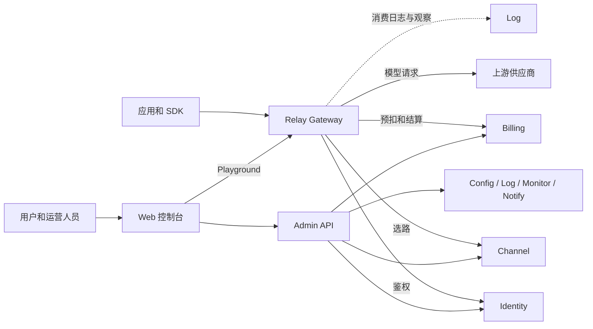
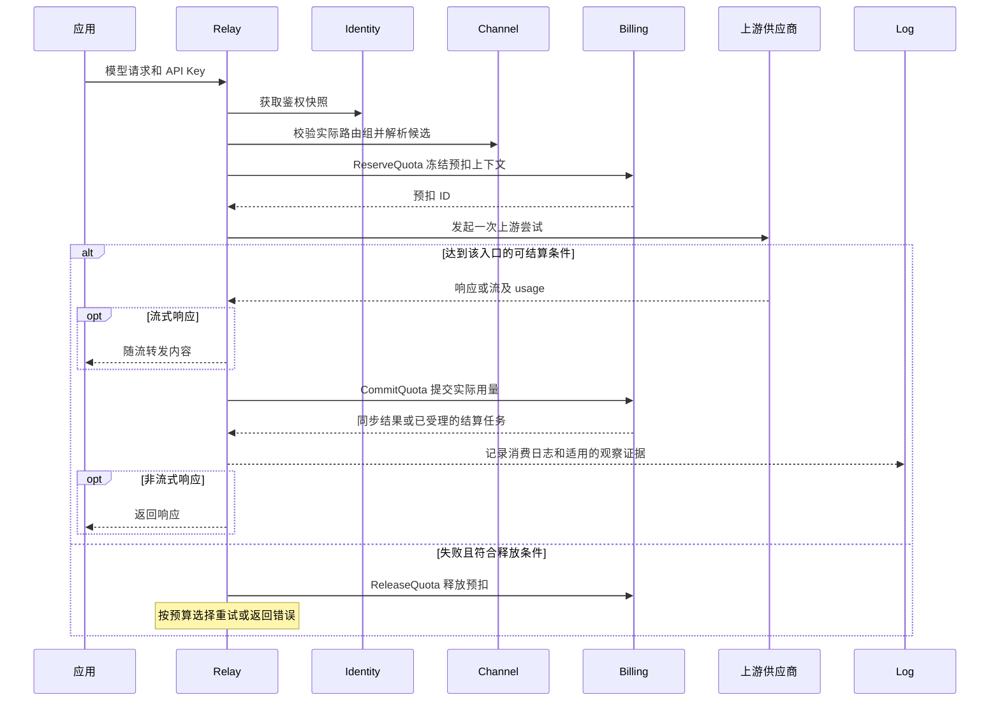

# micro-one-api 架构设计与服务边界

> 基线为 2026 年 11 月 20 日的 `develop@ea86343c`，对应 [v0.47.0](../releases/release-v0.47.0.md)。部署拓扑以仓库清单为准，生产验收以各条发布和运维记录的时间与范围为准。

micro-one-api 为应用提供统一的模型调用入口，为用户和运营人员提供密钥、路由、定价、账务与监控管理。仓库包含九个常驻应用角色。Relay 承担模型请求执行，Admin API 聚合控制台，Identity、Channel 和 Billing 分别掌握访问资格、可用来源与财务结算。应用可以按进程发布，数据库仍有共享订阅域和跨 schema 兼容关系。

## 1. 系统拓扑

实线表示主要调用方向，虚线表示日志与观察投递。浏览器和 SDK 使用 HTTP，模型请求支持按入口使用 JSON、SSE 或 WebSocket。服务间主要使用 Protobuf/gRPC，部分管理代理、通知和支付回调使用 HTTP。参考 Compose 用服务名寻址，代码支持按配置接入 Consul。SQL 持久化业务状态，Redis 支持共享缓存、限流、租约和事件流。 [参考 Compose](../../deployments/docker-compose/docker-compose.yml) · [Relay 装配](../../cmd/relay-gateway/wire.go) · [Admin 客户端装配](../../app/admin/cmd/admin/admin_helpers.go)

Go 后端使用 Kratos、Wire 与 GORM。`api/` 保存对外契约，`service` 在 DTO 和领域对象之间转换，`biz` 管用例及仓储接口，`data` 实现持久化，`cmd` 装配依赖。Relay 入口在根 `cmd/relay-gateway`，实现位于根 `internal/`。其余应用位于 `app/`，共享领域逻辑位于 `domain/`，基础设施能力位于 `platform/`。 [分层规则](../../AGENTS.md) · [依赖版本](../../go.mod)

CI 检查跨应用 Go 实现依赖、分层和 Wire 装配。跨 schema SQL、共享数据写入和混版行为仍需各领域的迁移、集成与端到端验证覆盖。 [架构检查](../../scripts/check-architecture.sh) · [CI](../../.github/workflows/ci.yml)

## 2. 服务边界与写入归属

| 常驻角色 | 职责 | 权威写入或负责维护的状态 | 代码入口 |
| --- | --- | --- | --- |
| `relay-gateway` | 模型 API、请求准入、执行计划、候选重试、协议适配、流生命周期及结算发起 | 执行期状态，如会话粘滞、运行时阻断和留证投递队列。通过各 owner 接口提交用量、扣费和日志 | [Relay Wire](../../cmd/relay-gateway/wire.go) · [路由表](../../internal/server/routes.go) |
| `admin-api` | 用户及运营控制台的 BFF，托管 SPA，聚合资源操作、定价发布与操作审计 | `system_options` 中的售价和基础倍率等配置、公告、备份控制及本服务审计。通过共享订阅域管理套餐、额度策略和人工订阅变更 | [Admin Wire](../../app/admin/cmd/admin/wire.go) · [HTTP 路由](../../app/admin/internal/server/http.go) |
| `identity-service` | 注册、登录、会话、MFA/Passkey、IAM、模型 API Key 校验和签发 | 用户身份字段、角色与授权、会话、API Key 状态和限制、用户默认组与路由授权事实 | [Identity Wire](../../app/identity/cmd/identity/wire.go) · [路由资格](../../app/identity/internal/biz/routing_access.go) |
| `channel-service` | 模型与上游来源目录、候选能力、组及成员关系、来源健康与凭证管理 | 渠道、上游订阅账号、路由组、模型映射、来源契约、用量与健康状态 | [Channel Wire](../../app/channel/cmd/channel/wire.go) · [渠道用例](../../app/channel/internal/biz/channel.go) |
| `billing-service` | 钱包、预扣与结算、充值支付、退款、兑换、订阅交易、成本和对账 | 钱包字段、预扣、账本、订单、账务执行证据、冻结价格和订阅扣费明细、结算任务、组结算策略与用户专属价格覆盖 | [Billing Wire](../../app/billing/cmd/billing/wire.go) · [结算用例](../../app/billing/internal/biz/billing.go) |
| `config-service` | 带版本和权限控制的动态配置管理 | `configs` 配置资源、版本和删除状态。价格发布由 Admin 与 Billing 的价格边界承接 | [Config 服务](../../app/config/internal/service) · [迁移归属](../../migrations/ownership.yaml) |
| `log-service` | 消费日志、选路事件、请求计时与独立 usage 观察的采集和查询 | 日志和观察数据，含入库去重记录。财务更正由 Billing 执行 | [Log Wire](../../app/log/cmd/log/wire.go) · [Log 服务](../../app/log/internal/service) |
| `monitor-worker` | 定期巡检、来源探测、告警规则和健康汇总 | 健康检查记录、告警规则与探测预算。渠道资源状态通过 Channel 接口更新 | [Monitor Wire](../../app/monitor/cmd/monitor/wire.go) · [Monitor 用例](../../app/monitor/internal/biz) |
| `notify-worker` | 收取告警及通知，匹配规则，派发并记录重试和确认 | 通知规则、通知、投递状态和处理租约 | [Notify Wire](../../app/notify/cmd/notify/wire.go) · [Notify 用例](../../app/notify/internal/biz) |

Web 是 React、TypeScript 和 Vite 构建的 SPA。控制台业务调用 Admin API，Playground 直接调用公共 Relay。管理写入沿用资源 owner 授权，服务身份用于限定内部调用能力，用户会话用于确定实际操作者。受 IAM 保护的 owner 使用自己读取的对象事实和固定执行点向 Identity 请求判定，列表先应用授权范围再计数和分页。 [Web 依赖](../../web/package.json) · [Owner 授权客户端](../../platform/authz/authz.go) · [IAM 交接](rbac/d-iam-production-deployment.md)

## 3. 模型请求与计费链路

下面以启用请求快照的执行路径为例。普通 JSON、流式、长连接和旧入口的完成时点各有差异。

1. **鉴权和选路。** Identity 提供 Key、用户和路由授权事实。Relay 解析模型、校验白名单，并结合 Channel 的可用组、模型及来源成员关系做执行计划。启用订阅权益时还合并合同事实。候选可来自普通 API Key 渠道或上游订阅账号，选择受优先级、权重、健康、并发限制及会话粘滞影响。切换候选时重检路由权限。有序组只在允许递进的情况下试下一组，授权拒绝和结算资格失败终止请求。 [Relay Plan](../../internal/biz/relay.go) · [路由上下文](../../internal/biz/routing_context.go) · [有序组](../../internal/biz/routing_ordered.go)
2. **预扣。** Billing 在上游发送前完成同步预扣。启用快照时，实际路由组、价格版本与适用的订阅合同、额度窗口随本次请求冻结。改价、变更合同或跨计价时段均沿用该请求的有效预扣快照。上游准入依赖真实授权和有效预扣结果。 [Relay 预扣适配](../../internal/server/http_billing.go) · [Billing 快照](../../app/billing/internal/biz/request_snapshot.go) · [跨时段验收](../runbooks/n1-pricing-closure-2026-11-14.md)
3. **转发与协议适配。** 传输层管理 HTTP 响应、SSE 和 WebSocket。适用路径由 adaptor 按渠道类型分发，再按入站协议和来源能力转换请求、响应或事件流。普通渠道可复用 ProviderFactory。Chat、Messages 与精确的 `POST /v1/responses` 有 executor 灰度门，原生 Gemini 入口直接使用 executor。Responses 子资源、WebSocket 和 gRPC Chat 保有各自的执行路径。 [适配器注册表](../../internal/adaptor/registry.go) · [协议适配](../../internal/apicompat) · [灰度入口](../../internal/server/orchestrator_gate.go) · [Gemini 入口](../../internal/server/gemini_handler.go) · [gRPC Chat](../../internal/service/relay.go)
4. **结算与恢复。** Relay 按入口终态和 usage 提交或释放预扣。非流式编排路径在返回前提交，SSE 输出随上游流消费，终态决定能否结算。上游已成功时，结算失败按原预扣查询和重试，避免重复发送。Billing 启用异步提交时先持久化任务再应答受理，后台恢复与同步回退复用同一提交逻辑。财务终态以 Billing reservation、账本和对应明细为准。 [执行编排](../../internal/server/orchestrator.go) · [Billing RPC](../../app/billing/internal/service/billing.go) · [结算任务](../../app/billing/internal/biz/async_billing.go)
5. **观察和对账。** 用 `request_id` 关联请求、日志和尝试，用 `reservation_id` 关联预扣与账本。消费日志有独立去重，受控财务执行留证和上游 usage 观察走各自的投递路径。售价账本、成本估价、上游供应商实际账单各有独立证据口径。 [消费日志](../../internal/server/http_usage_log.go) · [执行留证投递](../../internal/server/execution_delivery.go) · [usage 观察](../runbooks/upstream-usage-observation.md) · [供应商账务证据](../runbooks/vendor-evidence-overdue-2026-10-26.md)

### 路由与订阅术语

| 概念 | 作用 | 归属 |
| --- | --- | --- |
| 路由组与可访问资格 | 约束模型请求能使用哪些来源。Key 支持跟随默认组、绑定固定组或显式有序候选组，实际选中的组进入预扣上下文 | Channel 管组和来源成员，Identity 管用户授权与 Key，Relay 计算本次实际组 |
| 路由组价格与结算策略 | 定义对用户收多少以及可使用哪些资产。基础倍率、已发布的组策略和用户专属价格覆盖在预扣时解析 | Admin 维护 `system_options` 中的基础倍率，Billing 管组策略版本、用户专属覆盖和最终结算 |
| 用户订阅及额度策略 | 定义用户购买的权益、期限、适用组、额度窗口和消耗规则。合同可分别表达组访问资格与费用覆盖 | Admin 管政策和人工变更，Billing 管交易与扣费。Relay 读取权益用于准入 |
| 上游订阅账号 | 平台用于转发的来源资源，含凭证和账号用量限制 | Channel 管账号与来源，Relay 管本次执行，Billing 记录适用的财务证据 |

短期固定组 Key 同时约束到期时间、有限 Token 配额与模型白名单。其中 Token 配额在用量结算后扣减，用尽后拒绝后续请求。前置预算仍由 Billing 预扣和入口限制约束。 [分组运行手册](../runbooks/routing-groups-runbook.md) · [短期 Key 发布说明](../releases/release-v0.47.0.md)

## 4. 数据边界与一致性

| 数据或状态 | 当前边界 | 对架构的约束 |
| --- | --- | --- |
| SQL 与 schema | 参考 MySQL Compose 支持共享 DSN 和按服务 schema 配置，迁移声明八个 schema owner。Relay 无自有业务 schema。MySQL 拆分脚本为 Billing 暴露 `users`、`channels`、`logs` 和 `system_options` 等跨 schema 视图 | 进程可分开发布。现有 SQL 兼容层要求相关 schema 及权限可达，跨数据库实例迁移需要先替换这些依赖。历史生产分库记录见数据流复盘。 [迁移归属](../../migrations/ownership.yaml) · [拆分脚本](../../migrations/schema_split.sql) · [历史记录](../data-flow-closure-analysis.md) |
| 用户与钱包 | Identity 管 `users` 中的身份字段，Billing 事务更新同一历史表中的钱包字段。Identity 管 Key 配额，用量按结算结果回写 | 变更用户表应同时核对身份字段和账务字段。钱包与账本的一致性依赖 Billing 的事务和扣费状态迁移。 [钱包仓储](../../app/billing/internal/data/account_repo.go) · [迁移归属](../../migrations/ownership.yaml) |
| 订阅共享域 | `domain/subscription` 由 Admin、Billing 和启用相关功能的 Relay 进程内复用。订阅迁移归入 Billing。Admin 管计划、策略与人工变更，Billing 在同一财务事务内写入实际用量，Relay 读取权益或做预检查 | 三个进程指向同一权威订阅库。独立发布时需兼顾共享域 schema、状态和快照兼容。 [订阅域](../../domain/subscription/README.md) · [Billing 装配](../../app/billing/cmd/billing/wire.go) · [Relay 预检查](../../internal/server/subscription_middleware.go) |
| 上游账号额度快照 | Channel 更新 `account_quota_snapshots`。历史 MySQL 拆分脚本将物理表迁到 Billing schema，再通过 Channel 视图访问 | 拆迁或收紧 SQL 权限时，同时核对实际 writer 和物理表位置。 [Channel 仓储](../../app/channel/internal/data/data.go) · [拆分脚本](../../migrations/schema_split.sql) |
| 系统选项与动态配置 | Admin 管 `system_options`。Billing 从中读取报价配置，Identity 从中读取部分站点策略。Config 拥有独立的 `configs` | 修改定价时核对 Admin 发布、Billing 读取和在途快照，修改站点选项时核对 Identity。 [Admin 选项装配](../../app/admin/cmd/admin/admin_helpers.go) · [Billing 价格仓储](../../app/billing/internal/data/pricing_config_repo.go) · [Identity 数据层](../../app/identity/internal/data/data.go) |
| 缓存与事件 | Relay 接线包括按 Token 缓存的部分鉴权读取及可选的 Channel 缓存。带客户端 IP 或启用 v2 路由时，直接查 Identity。路由变更可在 owner 事务内写 outbox，再通过 Redis Streams 通知 Relay 失效缓存 | outbox 支持提交后重试，生效仍经过异步传播。预扣前和候选重试处应以各路径明确的授权检查为准。通用事件总线另有进程内默认实现。 [鉴权缓存](../../internal/data/cached_identity.go) · [路由 outbox](../../platform/routingoutbox/outbox.go) · [事件总线工厂](../../platform/events/factory.go) |

合同化套餐购买或变更由 Admin 调 Billing。Billing 在一个事务内提交订阅变更、钱包扣减、账本及幂等收据。旧版余额购买覆盖额度策略和套餐，由 Admin 调 Billing 扣款，再通过共享域发放或续期，失败时按旧流程补偿。旧版已付款订单也有 Admin 发放入口。 [Admin 订阅入口](../../app/admin/internal/service/subscription.go) · [Billing 交易用例](../../app/billing/internal/biz/subscription_commerce.go)

## 5. 架构取舍和优劣对比

| 取舍 | 当前选择的收益 | 当前选择的代价 | 替代方案及适用条件 |
| --- | --- | --- | --- |
| 单仓库、多进程 vs 单进程模块化应用 | 共用 Proto、迁移、工具链和端到端测试。Relay、控制台和任务 worker 可独立发布，执行负载可分开分配资源 | 请求链增加 RPC、超时和混版兼容要求。单机仍需维护多个进程 | 单进程减少调用和部署面，适合资源和角色均很少的场景，故障与容量更集中 |
| 逻辑分库与共享订阅域 vs 服务物理独立库 | Billing 可在本地事务内处理预扣、钱包和订阅窗口，管理与执行复用同一订阅规则。支持从历史共享表逐步迁移 | `users` 共享字段、跨 schema 视图及共享订阅表形成数据耦合，独立搬库、授权和恢复更复杂 | 物理独立库需要先划定钱包存储、替换跨库读取并定义订阅写入与跨服务补偿，适合数据隔离或团队独立运维有硬要求时 |
| 同步准入、按配置异步结算 vs 全同步或全异步 | 上游发送前取得授权和预扣。异步提交可缩短部分等待，持久化任务可恢复 | 异步受理与财务终态存在时间差，需要积压、幂等、对账与恢复验证。Identity、Channel 和 Billing 仍影响请求可用性 | 全同步更容易解释完成时点，结算成本直接进入延迟。全异步更适合可排队的离线任务，在线模型调用仍需定义准入和资金保障 |
| 多协议 adaptor 和 executor 灰度 vs 单一路径直接透传 | 同一模型入口可接多类来源，允许按入口和 Token 构造对照、逐步迁移和回退 | 协议、流模式、usage 语义和灰度双轨扩大测试矩阵。缺同窗样本时很难判断性能差异 | 单协议透传路径更短，适合协议和来源固定的使用场景。统一 executor 全量准入依赖同窗可比的成功率、延迟、账务、失败恢复证据 |
| Redis Streams 加 SQL outbox vs 引入独立消息平台 | 复用现有 Redis，在业务提交后重试路由失效投递，基础设施较少 | 同一 Redis 承载多类任务，积压、恢复、隔离和失效窗口要共同管理 | 独立消息平台适合事件流量、保留期或跨集群隔离有明确要求时，会增加部署与消费治理成本 |
| 单机 Compose vs 多节点部署 | 安装与回退步骤短，可逐服务换镜像。Lite 使用 SQLite 提供更轻的本地运行方式 | 宿主、MySQL、Redis 仍可形成共同故障域。SQLite 的写并发受单文件限制。Web、迁移、服务制品须配合发布 | 多节点编排能扩大应用层故障隔离，生产高可用还要单独落实入口、SQL、Redis、状态恢复与容量验收 |

## 6. 部署与运行边界

| 形态 | 仓库中的配置及适用范围 |
| --- | --- |
| MySQL Compose | 九个应用角色，附 MySQL 8.0、Redis 8.4、一次性 `migrate`，以及 Prometheus、Alertmanager、Jaeger、Grafana。默认映射 Relay HTTP、Admin HTTP 和 Grafana。Relay 提供内部 gRPC 供 Monitor 等调用。 [MySQL Compose](../../deployments/docker-compose/docker-compose.yml) |
| PostgreSQL 与 SQLite Lite | 均保留应用进程边界和 Redis。PostgreSQL 使用服务端数据库，Lite 使用共享 SQLite 文件卷，适合单机低写并发。 [PostgreSQL Compose](../../deployments/docker-compose/docker-compose.postgres.yml) · [Lite Compose](../../deployments/docker-compose/docker-compose.lite.yml) |
| Kubernetes | 仓库提供应用清单、Ingress、网络策略和部分应用的 HPA/PDB。启用前需接入 SQL、Redis、Secrets 与实际镜像版本，并核对 SPA 资源和内部 gRPC 所需端口。 [Kubernetes 清单](../../deployments/k8s) · [部署手册](../deployment.md) |
| 生产发布与静态资源 | 已记录的生产部署采用远程 Linux/x86_64 Compose。服务制品在本机构建并按服务切换。Admin 从宿主机挂载的 `web/dist` 提供静态文件，前端和迁移各有发布步骤。 [部署与回滚](../deployment.md) · [v0.47.0 验收](../releases/release-v0.47.0.md#验证) |
| 扩展执行角色 | 渠道账号任务的分片 worker 由同一 Channel 制品按 profile 启动。托管备份由 Admin 管任务，宿主 `backup-worker` 执行归档和隔离恢复，覆盖 MySQL 和独立 Redis。P3 操作角色使用独立状态库及审阅收据。 [账号任务 profile](../../deployments/docker-compose/docker-compose.yml) · [备份域](../../domain/backup/README.md) · [操作任务域](../../domain/operations/README.md) |

Monitor 经 Channel 获取来源并写回健康检查结果，受限上游探测经 Relay 执行。Prometheus 经 Alertmanager 向 Notify 投递告警，Billing 可按配置提交对账和订阅到期通知。启用 tracing 时可用请求 ID 和 trace 关联阶段耗时。单机备份应以可读回的异机归档和隔离恢复验证能力。 [Monitor 装配](../../app/monitor/cmd/monitor/wire.go) · [告警配置](../../deploy/alertmanager/alertmanager.yml) · [追踪配置](../../deploy/jaeger/config.yaml) · [异机恢复验收](../runbooks/n2-offsite-recovery-2026-11-09.md)

Relay 横向扩展时，共享 Redis 状态用于协同限流、阻断和会话路由。正在运行的 SSE、WebSocket、连接池和本地留证队列仍归各实例。滚动更新需要考虑长连接排空和未投递证据，跨副本行为以多实例验证为准。 [Relay 装配](../../cmd/relay-gateway/wire.go) · [多副本验收手册](../runbooks/subscription-redis-multi-replica-runbook.md)

截至基线日期，发布记录已有短期固定组 Key、跨时段冻结计价及 Billing 自然对账的生产证据。Executor 全量开关关闭，两枚 Token 在灰度，正式七天窗口缺同窗 legacy 对照。独立 usage 观察、Passkey 真实设备、Rerank 真实付费等验收范围以当前路线图登记为准。 [发布验收](../releases/release-v0.47.0.md#验证) · [Executor 观察](v0.23-executor-observation.md) · [当前路线图](next-stage-plan-2026-11-08.md)
