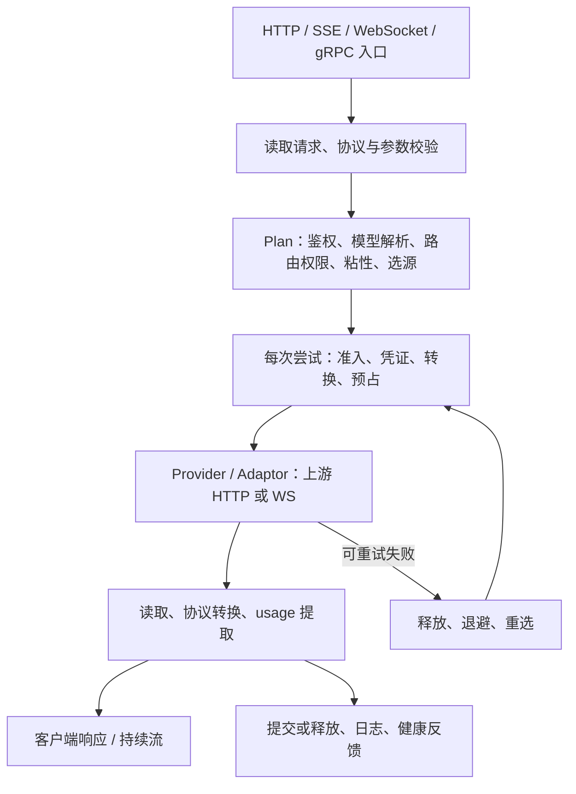

# 大模型调用链分段耗时与管理端展示方案

- 日期：2026-10-16
- 状态：已完成源码交叉审查的技术方案，尚未实施
- 分析依据：当前本地源码、Relay 执行边界 ADR、已有 O2 可观测性验收记录；本次未连接生产环境。

## 1. 建议与交付边界

复用现有 **OpenTelemetry → Jaeger** 链路，补齐“请求 → 尝试 → 阶段”的 span 树；管理端在现有调用日志详情中增加调用链瀑布图，并补充无账单请求的查询入口。请求摘要由 log-service 保存，详细 span 由 Jaeger 保存，Prometheus 继续负责整体延迟分布。

第一版覆盖模型执行路由的应用可观测边界：HTTP / SSE / Responses WebSocket / Relay gRPC 的请求接收、校验、鉴权、路由、准入、预占、上游请求、响应转换、下发、重试、提交或释放、日志与健康反馈，以及它们调用的内部服务、缓存和数据库操作。包含这些路由的拒绝和提前返回；健康检查、metrics、模型目录查询、管理查询和 CORS 预检不生成模型请求摘要。

“每个环节”指上述明确命名的业务阶段及其关键 I/O，不是为每个函数或 token 建立 span。供应商内部排队、prefill、模型推理各自耗时不能由网关准确拆出；上游等待按网关实测展示。客户端真正收到内容的时间、网关前的 CDN/反向代理耗时也不在当前应用测量范围内。

详细链路首版沿用 Jaeger **48 小时**保留期，摘要跟随日志保留策略。超过保留期仍能看摘要，不能继续展开完整瀑布图；若要求长期保留每个阶段，需把扩大 trace 存储容量纳入同一发布计划。

## 2. 当前真实调用链与已有基础



图表示阶段关系；实际顺序以入口为准。例如 legacy 非流式 Chat 先提交计费和写日志，再返回响应；流式 Chat 在输出结束后执行提交与日志。不能为了画图调整现有结算顺序。

| 已有能力 | 当前证据 | 对新功能的意义 |
| --- | --- | --- |
| HTTP OTel 根 span、trace 响应头、OTLP 批量导出 | `platform/tracing/trace.go:35,177`；`cmd/relay-gateway/main.go:20` | 复用 SDK 和导出器；当前主要只有 HTTP 入口 span |
| Jaeger、Grafana 数据源、Badger 48h TTL | `deploy/jaeger/config.yaml`；`docs/runbooks/o2-otel-export-2026-09-27.md` | 不需要另部署一套追踪系统；历史记录不等于本次确认线上状态 |
| 根请求与尝试身份 | `domain/requesttrace/attempt.go:1`；`internal/biz/retry.go:541` | 可串起切源重试、预占与结算 |
| 路由审计与尝试查询 | `internal/biz/relay.go:576`；`app/admin/internal/server/http.go:3850` | 已有 Plan 总耗时、选路结果和账务尝试；缺阶段明细 |
| 上游 HTTP 共用观察点 | `domain/upstream/evidence/http.go:84` | 在同一边界采集连接与传输时间，避免逐 provider 重复实现 |
| 管理侧调用日志与选路审计组件 | `web/src/pages/admin/LogsPage.tsx:460`；`web/src/components/admin/RoutingAuditDialog.tsx:64` | 在现有详情中增加瀑布图，无需新图表依赖 |

必须处理的现状：

1. **执行路径并不统一。** `internal/server/routes.go:69` 注册 legacy、raw、proxy 等入口，orchestrator 受开关与 token allowlist 控制；WS、`internal/service/relay.go:65` 的 gRPC 还有独立执行路径。只给新 executor 插桩会漏流量。
2. **gRPC 尚未形成分布式 span 树。** `platform/grpc/xgrpc/metadata.go:17` 仅传兼容性的 `x-trace-id`；实际连接和服务端还需挂接 W3C 上下文传播及 client/server span。
3. **旧 `elapsed_time` 口径不统一。** 例如 `http_chat_handler.go:210` 在 commit、ingest 和 writeJSON 前取值；流式又在输出结束后取值。保留原字段兼容，新增明确口径，不追溯推算历史阶段。
4. **管理“调用日志”来自账务 ledger。** `app/admin/internal/server/http.go:3951` 调 `GetLedgerEntry`，`app/admin/internal/service/admin.go:496` 把 `ReferenceId` 暴露成 `request_id`；消费账单的引用可为 reservation ID。不能把它直接当作 RootRequestID，更不能把账单列表当作所有请求的索引。
5. **响应后与异步任务会断上下文。** `http_billing.go:105` 的日志路径从 Background 派生；billing 异步结算任务和 log 批写任务也需要显式携带 trace 关联。

## 3. 统一耗时口径

同进程耗时使用 Go 的单调时钟测量；时间轴保存开始时间和持续时间。对外统一为毫秒，可带小数；原始纳秒或微秒在后端完成转换，避免前端混用单位。“接收”从对应的应用观测入口计，HTTP 不是 socket accept 时刻；WS 从本轮完整请求帧读到开始，连接握手和读帧等待单列；gRPC 从传输层可观测的 RPC 开始计。

| 指标 | 起止边界 | 说明 |
| --- | --- | --- |
| `output_duration_ms` | 应用观测入口 → 本次输出结束事件 | HTTP/SSE 是协议终态及最后 Write/Flush 返回，WS 是本轮最后一帧写入返回；失败记录截止时刻和 incomplete，不称为客户端响应完成 |
| `handler_duration_ms` | HTTP route handler 开始 → 返回；gRPC service handler 开始 → 返回 | 明确所属 handler；gRPC 不含 handler 外的解码/编码/发送，WS 不使用整条连接的 handler 时长代替单轮 |
| `turn_duration_ms` | 本轮 WS 请求帧读到 → 本轮输出和同步处理均结束 | 每轮独立；失败或连接断开也结束并记录原因 |
| `rpc_duration_ms` | gRPC transport Begin → End | 包含可观测的解码/发送结果；不推算不存在的 Write/Flush 里程碑 |
| `first_content_ms` | 网关接收 → 首个有效输出成功写入/flush | SSE/WS 适用，包含之前失败尝试和退避 |
| `upstream_ttfb_ms` | 本次上游调用开始 → 首个响应字节 | HTTP 字节级指标，可能只是响应头，不等于首 token |
| `upstream_first_content_ms` | 本次上游调用开始 → 解析到首个有效输出 | 记录输出类型：text / reasoning / tool_call 等；role、ping、created 事件不算 |
| `upstream_duration_ms` | 上游调用开始 → body EOF / terminal / 取消 | SSE 不能在 `client.Do` 返回或拿到 stream handle 时结束 |
| `retry_backoff_ms` | 进入退避 → 实际结束等待 | 与重选、上游调用分别记录 |
| `queue_wait_ms` | 实际入队 → 开始处理 | 只用于真实队列；TryAcquire 立即拒绝不伪装成排队 |
| `settlement_duration_ms` | 提交或释放阶段开始 → 返回 | 异步模式再展开排队、worker、事务；入队成功不等于落账 |
| `log_ingest_ms` / `log_flush_ms` | 日志 RPC / 实际批写各自边界 | 入队确认与数据库持久化分开 |

补充规则：

- HTTP 小响应可以缓冲至 handler 返回，Flush 返回后也可能仍有代理/网络缓冲。`output_duration_ms` 只叫“应用输出耗时”，不是服务器完整发送或客户端接收时长；未执行对应输出的请求不填该值。仅终态/最后一次写出成功才标 output complete，单独保留写失败和取消结果。
- DNS、TCP、TLS 采用 `net/http/httptrace` 回调；连接复用显示“复用，未新建”，不填假的 `0 ms`。`GetConn → GotConn` 包含连接获取与建连，其 DNS/TCP/TLS 子阶段不能再相加。
- HTTP 首响应字节与首 body、首协议事件、首有效输出分别记里程碑。非流式请求不展示伪造的 TTFT；二进制透传可显示首 body 指标。
- 读取上游、解析转换和写客户端是流水线，允许重叠。显示父子关系、开始偏移与持续时间；父子 span、RPC client/server span 不可简单累加。自身耗时需扣除子区间的并集，不能直接减所有子 span。
- 慢客户端可能拉长流复制时间，界面使用“流传输/输出”，不将整段标为“模型生成”。未覆盖部分显示“未细分”，不能自动归因某个服务。
- 跨进程绝对时间可能有时钟偏差；持续时间在各进程独立测量，部署保持时间同步，时间轴发现异常时提示偏差，不把负偏移伪造成零耗时。
- 流中断、客户端取消、上游失败、业务完成、结算失败分别记录。HTTP 200 或 WS 101 不能代表模型调用成功；沿用现有 terminal/usage 判据。

## 4. 插桩设计与责任归属

命名固定、维度有界；各路径执行同名阶段，但保持原有执行顺序。

| span / 阶段 | 首选采集位置 | 展开内容 |
| --- | --- | --- |
| `relay.request` | `routes.go:137`、`platform/tracing`；gRPC transport 入口；WS turn 入口 | 路由模板、协议、执行路径、业务结果；覆盖对应观测入口之后的早退 |
| `request.parse` | HTTP 适配边界与 gRPC transport 观测 | 读取/解码/参数校验；protobuf 解码在 unary interceptor 之前，不能仅在 service 打点 |
| `relay.plan` | `internal/biz/relay.go:603` | `auth.snapshot`、模型映射、路由上下文/权限、粘性、选源 |
| `relay.attempt` | `retry.go:666`，adaptor 内部重试及 orchestrator 相应入口 | 尝试序号、来源类型和 ID、上游模型、预留 ID、结果 |
| `admission.check` | 并发/RPM/会话窗口执行处 | 准入结果；有真实等待才单独计 wait |
| `credential.resolve` / `request.transform` | `http_adaptor.go:516,573` 等共享边界 | 凭证解析/刷新、协议转换和参数合同处理；不记录凭证或正文 |
| `quota.reserve/commit/release` | `http_billing.go:117,237,604`，gRPC 对应端口 | 展开 billing RPC 与内部缓存/事务 |
| `upstream.http` | `domain/upstream/evidence/http.go:84` | 每次实际发送、连接事件、首字节、响应读取；不受现有 evidence 开关决定是否采集 |
| `response.transform` / `response.stream` | provider/adaptor 解析器、stream Read/Close 与客户端写出边界 | 首有效输出、terminal、流结束、写错误；固定里程碑，不按 token 建 span |
| `retry.backoff` / `route.reselect` | `internal/biz/retry.go:613` 及 adaptor fallback | 等待与重选分开；同一 attempt 的协议降级发送作为不同 send 子段 |
| `usage.log` / `health.report` | `http_usage_log.go:199`、健康反馈端口 | RPC、后台队列、必要存储操作 |

内部服务统一初始化现有 xtrace SDK。gRPC client/server 在 `platform/grpc/xgrpc` 挂接 `stats.Handler`，通过 TagRPC/Begin/InPayload/OutPayload/End 等事件完成上下文传播和 RPC client/server span；拦截器只补鉴权等处理子阶段。protobuf 解码发生在 unary interceptor 前，响应编码/发送发生在 handler 返回后，不能只用拦截器覆盖“全链路”。同一 RPC 的根 span 只由一处 transport instrumentation 创建，避免 stats 与拦截器各建一份。内部传播 `traceparent`、`tracestate`，兼容保留 `X-Trace-ID`；不能被普通用户覆写服务间的可信关联。

涉及 identity、channel、billing、log，以及它们在该请求上继续调用的 config 等服务。实际挂接点同时检查 Wire 路径和独立构造客户端路径；gRPC 在 RPC 归属建立前就被连接层拒绝的事件只有连接级观测，不承诺存在模型请求摘要。现有 Relay RPC 为 unary，无法精确测量的首内容/输出完成字段保持缺失，不以 service 返回时刻伪造。

各服务 data 层为关键缓存、数据库事务及 repo 操作补子 span，标识操作名、cache hit/miss、结果；不导出 SQL 参数或缓存 key 原文。biz 不引入数据库/Redis 类型，service 不访问存储，HTTP server 只承担传输计时和生命周期边界。无需先迁移或重构 legacy 路径。

WebSocket 另有 `connection` 与 `turn` 两种生命周期：连接/握手 span 只表示连接，以 connection ID 关联各轮；每个完整的 `response.create` 入站帧读到后立即建立独立 trace 和 observation，不能等上游响应 ID 出现才建请求。首轮在 `openai_ws_forwarder.go:110-183` 就已进行 Plan/RPM/预占，必须纳入该轮；后续轮也分别绑定该轮实际使用的已验证身份及 attempt/reservation，不能沿用首轮计时或追踪根。复用既有鉴权/路由结果时标记 reused，不为采集额外鉴权或改变路由策略。业务根请求/账务键仍按既有语义保留，新增观测身份独立区分每轮。连接池获取/拨号实际发生在哪一轮就计在哪一轮，复用时不重复计拨号。

当前 `openai_ws_relay.go:597-604` 在 `writeClient` 前调用 `finishTurn`，其回调会同步结算/写日志。因此必须分别记录 upstream terminal、终帧写出完成和 turn 同步处理完成；不能把现有回调当作输出结束，也不能把终帧写出前发生的结算标成“响应后的后台阶段”。每轮输出及同步处理结束就独立结束 span/提交摘要，不等整条 WS 连接关闭；握手失败和没有有效 turn 的关闭仅记录连接级结果。

HTTP/SSE writer 观测复用现有 observation writer/ResponseController 模式，保留 Flush、Hijack、Unwrap 等所需能力，且不能把 heartbeat 或 role-only 帧的 Write 当作首内容。上游 HTTP 计时不得依赖 evidence recorder 是否启用：tracing 单独启用时也使用轻量 Read/Close 包装器记录 EOF/取消，不缓存完整正文或改变现有 durable evidence 行为。

## 5. ID、异步与生命周期

- `root_request_id`：保留业务根请求聚合语义；在其建立前已被拒绝的请求允许缺失，仍可凭 observation ID 和时间查询。
- `request_id`：保留每次尝试的账务幂等语义，不被 trace ID 替代。
- `observation_id`：每次 HTTP 请求、WS turn 或 gRPC RPC 由服务端独立生成；摘要主键和去重键不依赖 OTel 是否启用。
- `otel_trace_id` + `span_id`：追踪身份，由服务端产生或通过可信内部链路传播；未启用 SDK 时可为空，兼容 `X-Trace-ID` 另存，不能当作 OTel ID 或摘要唯一键。
- `reservation_id`：关联账务预留，允许一个根请求对应多个预留。
- `source_kind + source_id`：区分普通渠道与订阅账号的 ID 命名空间。

公网传入的 ID 不作为授权依据。公网 trace 上下文需要与内部上下文隔离：由网关建立本次逻辑请求的内部 trace，必要时以 link 关联外部 trace；内部 RPC 沿用该 trace。这样既不受外部 sampled 标记控制，也避免把多个用户请求拼成一条可被整体返回的 trace。

根入口创建请求内共享、并发安全的 observation recorder，派生 context 复用同一实例；不能指望内层 `context.WithValue` 的新 context 会回写到外层。鉴权成功后立刻绑定可信 user ID，再执行可能失败的路由；从存储路由/缓存恢复的已验证身份也显式绑定。这样“鉴权成功但路由失败”的摘要仍有正确归属。尝试开始、预占结果和输出结束在实际发生处更新，结束时仅快照一次；异步 worker 不修改已交给 exporter 的摘要。

同进程响应后任务使用保留 span context 的独立超时 context，沿用已有 `WithoutCancel(parent)` 模式，修正响应后日志的 Background 断链。HTTP 根 span 在 handler 完成时结束，WS 按轮结束，gRPC 根 span 在 transport End 结束；后台任务继续并单列展示，不把其持续时间并入应用输出耗时。OTel 未启用时仍能保存摘要，详情标 not_recorded，而不是把空 trace/span 拼成所有请求共用的去重键。

跨进程、可重放的异步结算/执行 outbox 在**任务外壳和独立列**保存 observation ID、`traceparent/tracestate`、首次接受时间及每次排队时间，worker 恢复上下文再创建处理 span。不能只增加 PO 列：当前 `settlement_task_repo.go:160-172` 仅从 payload 还原 SettleTask，`internal/data/execution_outbox.go:327-343` 仅返回 Event+Digest；必须将“持久化 → claim/Pending → 反序列化 → 入队 → worker → RPC 发送”的返回值和传输外壳一起接通，旧行缺遥测字段时正常执行。

首次接受的原始关联保持不变，金融幂等重放不重写 parent/首次接受时间；每次真实后台处理分别记录重试和本次等待。无效 carrier 只使追踪失联并计数，不拒绝结算、重发金融事件或改变重试策略。不能直接修改参与摘要计算的账务 payload、`execution.Event` 或 `Intent`：`domain/execution/event.go:78` 对事件 JSON 求摘要，遥测扩展不能改变财务证据或幂等语义。

log 批写在队列项中保留 enqueue 时间和 SpanContext；每条队列项的处理 span 留在原请求 trace，记录等待时间及服务端生成的 `batch_trace_id/batch_span_id`。共享 flush span 使用 links 关联多个请求，标明共享批次。管理查询通过这组明确引用补查获准的批次安全片段，不能假设 Jaeger 支持按 span links 反向检索，也不能把批次中其他请求的数据返回。批写不是每条请求独占的一次数据库写入，不重复累计其耗时。

## 6. 存储与查询 API

**详细数据存 Jaeger，请求索引和少量摘要存 log-service。** 不再建一份逐 span SQL 明细表。

建议扩展现有 logs，以 `source=relay-request-timing` 保存每个逻辑请求的一条结构化摘要，复用 ingestion、去重和清理能力。DTO 增加独立 `RequestTimingSummary`，biz 使用纯 DO，data 将其转换为 PO 的结构化 JSON 扩展；JSON 统一通过 `pkg/jsonx`。摘要与消费日志分开，不能计入 usage/费用统计。

这项复用必须同步修改现有过滤：`app/log/internal/data/data.go:343,599,709,805` 的数据库及内存用户列表/用量聚合目前只排除 `routing-selection`，新 source 也必须排除；仅把摘要 level 设成 info 不够。为“同一次调用新增摘要后，调用次数、token、费用和原用户日志列表不变”增加回归断言。

摘要包括版本、observation ID、可空的内部 trace/span ID、根请求 ID、用户归属、全部 attempts 的 request/reservation 关联、端点、协议、执行路径、请求结果、各完成时间、应用输出/handler/RPC/turn/首内容耗时、尝试数、主要阶段聚合和采集状态；最后尝试只是展示字段。未预占成功的尝试也保留，reservation 允许缺失；proto 使用 optional/明确 presence，不能用默认零值伪装已测得。去重键使用服务端 observation ID，不依赖可重复的外部 root ID 或可能不存在的 OTel ID。

请求结束后，外层观测器先固定原请求计时，再将不可变摘要交给 Relay 独立的有界 exporter queue，由少量 worker 调用日志 RPC，覆盖 body 限制、鉴权、路由、预占等提前失败。现有 `LogUsecase.IngestLog:227` 对带 DedupeKey 的请求同步写库，因此不能在请求 defer 中直接调用它并声称非阻塞；在摘要 worker 中复用其去重/持久化语义即可，不改变消费日志行为。鉴权完成前用户归属为 unknown，只向具备平台范围权限的管理员开放。摘要自身的导出不递归生成新的请求摘要；其导出耗时不计入原模型响应耗时。

现有 logs 没有摘要 JSON/OTel 字段，实施需要显式新增可空 `request_timing_json`（按方言选择 JSON/文本）、`observation_id`、`otel_trace_id`、`request_started_at_ms`、`request_outcome`；历史行保持 NULL。身份、时间、结果等检索条件落独立列，不能对全部 JSON 做扫描；`logs.created_at` 是写入时间，不代替请求开始时间。

全部尝试的精确关联使用小型 `request_trace_attempt_refs` 表保存 observation ID、可信 user ID、attempt number、request ID、可空 reservation ID，与摘要在同一事务持久化并按 observation 幂等。这是关联索引，不保存 span。按已授权 `user_id + reservation_id` 定位所有关联 observation；同一个幂等预留若确实对应多次观测，返回明确候选，不按 root ID 猜一条。只存最终 reservation 无法支撑完整重试检索，也不能把账单引用直接当成 log 行 ID。

补齐 MySQL / PostgreSQL / SQLite 迁移与内存 repo 行为；observation ID 建唯一索引，引用表建 `(user_id,reservation_id)`/`(observation_id,attempt_number)` 索引。logs 的根请求检索用 `(source,user_id,root_request_id,request_started_at_ms,id)`，无 root 的时间列表另用 `(source,user_id,request_started_at_ms,id)`，平台范围查询用 `(source,request_started_at_ms,id)`。状态在有界时间窗口内过滤，实施通过 EXPLAIN 验证；不能用 root 在前的索引替代时间扫描索引，也不在列表查询时逐行访问 Jaeger。

管理 API 的建议形状：

| API | 用途 |
| --- | --- |
| `GET /api/log/{ledger_id}/trace` | billing owner 授权并解析模型消费账单的 reservation，再按 user+reservation 查摘要；多次观测返回候选，0 条返回未采集；非模型账单不适用 |
| `GET /api/log/request-traces?start_time_ms=...&end_time_ms=...&outcome=...` | 独立查询无账单/失败请求；user_id、root_request_id 可选，实际范围仍受 owner 授权限制；没有用户 ID 也不能隐式获得平台范围 |
| `GET /api/log/request-traces/{observation_id}` | 获取选中请求的摘要与标准化瀑布数据 |

列表 DTO 明确使用 Unix 毫秒的半开区间 `[start_time_ms,end_time_ms)`，默认最近 24 小时、单次最多 7 天；outcome 为固定枚举，非法区间/枚举返回 400。默认 page_size=50，上限 200，按 `(request_started_at_ms DESC,id DESC)` 排序并使用不透明 page_token；首页固定 snapshot_max_id，后续页沿用筛选和快照，避免延迟入库/并发新增导致偏移分页重复或跳过。token 仅是游标，每页重新执行 owner 授权和 scope 谓词，不能以 token 中的用户或资源范围取代权限检查。列表只读摘要，未知用户只能由具备平台范围权限者查询。

领域 owner API 在 `api/log/v1` 定义 DTO，经 service → biz usecase → repo；Jaeger 访问客户端和 logs PO 位于 log-service 的 data 层，客户端由 `*Data` 持有，cmd/Wire 负责装配。admin 只做代理和账单关联，不在 `server/http.go` 增加追踪业务拼装。账单到 reservation/root 的解析由 billing owner 提供明确关联字段，不放在受费用权限脱敏的 request_snapshot_json 中，也不由前端猜测 ID。

耗时主查询不能整体复用 `handleRoutingAudit`：其先强制读取 billing attempts；也不能通过 `GetRequestSnapshot` 推 root，它会在没有费用权限时返回 nil。已授权的日志时间轴独立返回，billing attempts/费用/当前结算状态作为可选附加信息，缺权限或依赖不可用不阻断耗时查询。

Jaeger 2.20 官方提供稳定的 v3 HTTP/JSON 查询 API，可使用现有 net/http 与 jsonx 访问。程序接入优先用该稳定 API，避免把 UI 私有 `/api/traces/...` 响应格式扩散到业务接口。正式实施先对仓库固定版本做一次契约验证。[Jaeger API 文档](https://www.jaegertracing.io/docs/2.20/architecture/apis/)

后端返回稳定的展示模型：

```text
RequestTrace
  observation_id / root_request_id / otel_trace_id
  observation_kind / summary
  output_finished_at / handler_finished_at / turn_finished_at / rpc_finished_at
  detail_state / observed_at / detail_retention_hours
  attempts[]: number, request_id, optional reservation_id, source, outcome
  spans[]: id, parent_id, service, phase, attempt_number,
           start_offset_ms, duration_ms, outcome, safe_attributes
  milestones[]: kind, offset_ms, output_kind
  related_operations[]: batch/async link, status, safe timing
  settlement_snapshot / optional settlement_current: status, observed_at, source
```

展示状态至少区分 `available`、`pending`、`partial`、`expired`、`not_recorded`、`unavailable`。只拿到根 span 不等于完整：以摘要中的 observation kind、真实 attempts、已发生阶段/里程碑及同步终点校验预期数据，关联任务未完成或必要 span 缺失标 partial/pending，并返回缺失原因。Jaeger 暂不可用不等于请求失败；查不到 trace 也不能一律解释成过期。

摘要只保存结束时的结算快照；异步 Commit 返回 Success/AsyncEnqueued 不代表落账。查询当前状态时，按获准的 reservation 向 billing owner 读取权威预留/任务状态并返回 observed_at/source；无相应权限或 billing 不可用则缺失/未知，不从 span 结束、trace 缺失或过期推断结算成功。第一版不承诺实时查看进行中的全链路，请求刚完成时可有限次数刷新；WS 某轮已结束即可查询，即使连接仍开着。

## 7. 管理端展示

入口放在 `LogsPage` 已有日志详情中，增加“基本信息 / 用量计费 / 调用链”；消费记录能直接进入，充值/退款等无模型请求的账单不显示误导性调用链。列表如增加总耗时、首内容和重试数，使用批量摘要查询，不能触发 N+1 个 Jaeger 请求。

无账单请求在同一页面提供“请求链路查询”入口，复用现有 `RoutingAuditDialog` 的用户与根请求检索交互，展示匹配请求后进入同一详情组件。支持按时间、状态分页筛选失败请求，避免只能凭调用方手工提供 ID 才能找到失败链路。

默认展示应用输出耗时、首有效输出、重试次数与有权读取的结算状态；gRPC 用 RPC 耗时，WS 用单轮耗时，缺失的输出/首内容不显示为零。瀑布按真实发生顺序展开“准备 → 尝试 1 → 退避 → 尝试 2 → 收尾”，横轴为相对请求开始的时间；结算发生在终帧写出前时按该顺序呈现。每行同时展示阶段、服务、起始偏移、耗时和状态；点击展开网络/RPC/缓存/DB 子阶段及安全元数据。

以下仅为信息结构示意，数值不是生产测量：

```text
应用输出 3.20s · 首有效输出 0.86s · 重试 1 次 · 结束时结算已入队

请求准备
  鉴权 / 路由 / 准入
尝试 1：渠道 A                            220ms  上游 502
  预占 → 上游请求 → 释放
退避                                    100ms
尝试 2：订阅账号 B                       2.84s  成功
  预占 → 凭证/转换 → 连接 → 上游等待 → 流传输/输出
应用输出结束 ──────────────────────────────── 3.20s
后台收尾
  提交 / 日志入队 → 异步处理 / 实际落盘
```

失败条用颜色与文字共同标识；首内容、上游终态、应用输出结束和处理结束是独立刻度。默认保留失败尝试，不能只看最终成功来源。异步和共享批次与同步输出区分显示；历史无采集、未知、已过期、连接复用都有明确文案。使用现有 React Query、权限组件、Dialog、Table 和 CSS/SVG 横条即可，无需新增图表库。

## 8. 授权、数据与采集开销

复用 `log.request.list/read`，在 log owner usecase/repo 落实数据范围，按服务端请求归属验证；billing 解析账单关联也沿用 owner 授权。用户 ID/root ID/trace ID 只是定位条件，不能替代资源授权。浏览器不直连 Jaeger，不提供绕过归属校验的任意 trace 读取代理。

新增 List/GetRequestTraces RPC 必须注册 `platform/security/serviceidentity/registry.go` 的调用策略（UserCallers 仅 admin、无 SystemCallers），并加入 log-service 的 `logReadyMethods`；admin 传播 operator credential，owner 再做范围校验。摘要写入继续走 IngestLog 现有系统调用身份，不因此授予系统身份读取任意 trace 的能力。若暴露 owner HTTP 入口，也注册对应 HTTPContext/调用策略和覆盖测试；不能只写 proto/usecase 后绕过 IAM 接线。

耗时元数据不要求读取提示词权限；选路审计与费用分别沿用已有权限，缺费用权限仍能查看获准的耗时。API 仅返回允许的阶段元数据，不透传 Jaeger 原始 tags、供应商错误正文、完整 URL/query、Authorization、API Key、OAuth 凭证、prompt 或 response。

Jaeger 地址只来自可信配置。查询复用现有 5 秒 deadline、响应体限长的模式：建议整体 5 秒、累计最多 2 MiB/2000 spans、最多跟随 8 个明确关联操作，达到上限返回 partial/truncated 和原因，不静默遗漏后宣称完整；限额实施时用代表性长流/多次尝试验证。批次只返回匹配关联的共享安全片段，不递归遍历其余请求的 links。

采集目标为**每个目标请求记录摘要，保留期内全量采集必要阶段**。现有 Relay 是 100% 采样，新增服务使用一致的 ParentBased 决策；公共入口自行决定采集，不受外部 sampled 标记影响。降低到 10% 就无法承诺任意请求都有完整瀑布，不能静默以抽样替代需求。[OpenTelemetry 采样说明](https://opentelemetry.io/docs/languages/go/sampling/)

OTel 导出沿用非阻塞批处理，摘要使用上述有界队列；两者限制队列、worker 数、重试次数和超时，退出时有限等待 flush。关闭采集或导出故障时保持转发、计费与响应行为，导出失败/丢弃计数必须可见；这是一套观测系统，不承诺进程崩溃后追踪数据零丢失。现有 log 批写也有满队列/写失败丢弃行为，不能把“已入队”标成“已落盘”；带去重键的消费日志则仍按当前同步持久化语义处理。

Prometheus 只新增有限阶段标签的 histogram/counter，复用既有 dependency RPC 指标；不把 request、trace、用户或动态错误信息放进标签。分位数图用于总体趋势，单请求瀑布按摘要/Jaeger 查询。

当前 Jaeger 配置的 512 MiB 容器限制和 48h TTL 需要做容量验收。举例：假设平均 10 RPS、每请求 25 spans、每 span 1 KiB 编码数据，则 48h 约 4320 万 spans、41 GiB 原始数据量，尚未计算索引、压缩和副本；这是估算模型，不是当前流量或磁盘占用。阶段数和实际每 span 大小必须实测；容量不满足时优先调整存储/保留期并明确产品边界。

SQL 容量也需计入摘要与尝试引用、索引和去重事务的额外写入；不能只测 Jaeger。unknown 用户的公网拒绝请求同样会产生摘要，队列和查询必须保持有界，过载丢弃计数可见，不允许反压到模型转发/结算。正式清理摘要时一并清理关联行和相关去重记录，沿用 owner 删除范围及现有去重清理事务。

## 9. 实施切片与验收

| 切片 | 内容 | 完成标准 |
| --- | --- | --- |
| 1. 基础合同与采集 | 固定阶段/计时/独立 observation ID；transport 传播；HTTP/WS turn/gRPC 生命周期；观测入口之后的早退摘要 | 受控验收请求均可定位，鉴权失败也可由授权管理员查到；关闭 OTel 后摘要仍可区分，不更改账务 ID/digest |
| 2. 执行路径与后台阶段 | legacy、orchestrator、adaptor、raw/proxy、SSE、WS、gRPC；HTTP 网络里程碑；缓存/DB；异步关联 | 每条实际执行路径有完整的阶段树；重试与后台处理不丢关联 |
| 3. 管理查询与展示 | owner API、ledger→reservation→请求关联、失败请求查询、瀑布图、缺失状态、权限/i18n | 管理员能从账单或失败请求进入同一瀑布图，能区分内部慢、上游等、退避与流传输 |
| 4. 灰度与容量验收 | 固定假上游验证、受控流量、存储/CPU/延迟观测与降级 | 所有路径通过后再宣称全链路覆盖；观测故障不影响账务结果 |

至少覆盖以下验收场景：

- 输出边界：非流式小响应缓冲、SSE 心跳/空事件后才有内容、连接复用、客户端取消/半途断流；wrapper 保留 Flush/Hijack 能力；只开启 tracing、未启用 evidence 时仍能结束上游 span。
- WS：首轮含 Plan/预占、后续轮独立、连接持续打开时已结束轮可查、failover、终帧前同步结算延迟、上游 terminal 后客户端写失败。
- gRPC：正常 unary、malformed protobuf、service-token 拒绝、响应编码/发送失败；验证 transport 根与处理子 span 不重复，缺失输出指标不伪造。
- 身份/摘要：鉴权成功但路由失败、bodylimit 早退、OTel 禁用时连续请求仍各有唯一摘要、全部失败尝试及未预占尝试、同 root 多次请求/幂等预留返回明确候选、摘要不改变既有统计和用户日志列表。
- 异步：结算入队后实际成功/失败、跨进程重启恢复、幂等重放不改原 parent、损坏/缺失 carrier 不影响账务结果；log 多请求共享批次安全关联；摘要/引用/去重原子持久化和清理。
- 查询/授权：无 root 的时间/状态分页、迟到入库下翻页不重复；新 RPC 经真实 IAM 传输可用、跨用户拒绝、有日志权限但无账单/费用权限仍可查获准链路；backend 超时、限额截断、单个根 span 缺子阶段、Jaeger 故障/延迟/过期及历史兼容。

使用可控 fake ports/假上游与内存 span exporter 断言真实层级、里程碑顺序、结果、同一 trace 关联和结束时机；使用本地 Jaeger 验证 v3 查询转换。现有测试可从 `route_observation_test.go`、`request_attempt_test.go`、stream cancellation、WS 和 billing async 测试扩展，避免只测计时 helper。

并发压测核对开启/关闭采集的响应 P95、CPU、内存、导出丢弃率和存储增长；建议以网关额外 P95 开销不超过基线 5%、受控验收流量无丢弃为初始发布门槛，最终阈值依据基线确定，不承诺未经测量的固定开销。

影响范围包括 DTO/proto 与生成文件、相关 DO/repo/PO、任务恢复/传输外壳、三种数据库迁移、查询和清理、Wire、gRPC stats、服务启动和部署配置、serviceidentity/owner ready 注册、前后端类型/权限/i18n/fixtures，以及上述测试。先上线可空列/引用表与兼容 consumer，确认所有 owner 实例均可往返保存新增字段及关联，再启用 producer 和管理查询；不能因旧 consumer 会忽略未知字段就提前投递摘要，否则可能成功应答却丢关联。历史缺采集标 not_recorded，不推算耗时。回滚先停 producer/新 UI，保留可空列和观测数据，不做破坏性反向迁移。本功能实施时通过 `make api` / `make all` 生成，禁止手改生成文件。部署遵守本地 linux/amd64 交叉构建，前端 dist 单独发布，不在生产服务器构建。

## 10. 本次分析范围

本次仅新增方案文档，没有修改运行时代码、执行构建/测试、访问线上环境或部署。未核实当前生产开关、实时请求量、磁盘容量及实际 Jaeger API 响应；这些属于实施后的契约和灰度验收工作。

首版不增加新的追踪平台、全量 span SQL 副本、逐 token 事件、请求正文采集或 tracing 数据零丢失保证。供应商内部处理和客户端实际接收时间保持“不可观测”边界。
