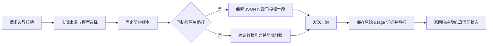

# 上游接口变更适应方案

实现复审（2026-10-15）：补齐有限规则冲突/精确边界、repair 授权期限、恢复与回滚灰度窗口、候选隔离、探测周期/预算及真实 SSE 独立回放；同步修复计费与采购证据接缝。见[实现复审与回归证据](../runbooks/billing-upstream-review-2026-10-15.md)。后续生产更新已随下述管理页面发布完成，真实收费和供应商费用核验保持各自现场关卡。

管理页面与运营入口更新（2026-10-15 开始，2026-10-16 已发布）：补齐“供应商核验” `/admin/vendor-reports` 与“上游契约” `/admin/upstream-contracts` 页面和菜单，修复 owner gRPC ready 方法漏登记导致读取返回 403 的问题。本轮仅为 root 启用并绑定 `billing.vendor_report.read`、`channel.upstream_contract.read` 两项读取权限；报告导入/归因、契约创建和状态变更仍受各自独立授权与门禁约束，真实调用及收费开关保持原值。版本、迁移、前端和实际访问验证见[管理页面生产更新记录](../runbooks/evidence-management-pages-deploy-2026-10-16.md)。

日期：2026-10-13。代码基线：`91e5686f`。阶段接续：按用户指令以 P0/P1/P2 已完成为基线，当前补齐 P3 运营闭环。各历史记录保持当时边界；本轮真实账期/生产灰度按明确指令保留门禁。

DeepSeek 官方试点（2026-10-14）：已完成 deepseek-flash 六次真实推理，覆盖 JSON/SSE/tool/缓存与扩大输入样本。原生响应与官方导出均为 140,333 token，按原币估价和实际费用导出均为 0.14036956 CNY；本轮余额扣减 0.14 CNY 与分位精度相符。费用快照已核对，完整日账期尚未关闭，候选仍未注册收费。见 [扩大余额核验与渠道 1 诊断](../runbooks/deepseek-balance-and-channel1-2026-10-14.md)；首次四次证据保留于 [初次试点](../runbooks/deepseek-official-pilot-2026-10-14.md)。

P2 后续工程进展（2026-10-14）：typed contract/不可变版本/CAS、有限规则与快照执行、持久协议事故/TTL 验证、受控 canary proof、灰度/回滚及报告 IAM/API/日报覆盖已接通。见 [P2 工程交付与现场边界](../runbooks/billing-upstream-p2-completion-2026-10-14.md)。P2.1 的 amd64 工具制品缺口已用本地 buildx/CGO 补齐；真实账期/生产窗口仍独立待验，未部署或扩大收费。

P2.1 工程进展（2026-10-13）：固定账号/账期 CSV、原币 decimal、attempt 采购去重、内部费用分离、不可变报告/更正链及归因回放已实现。见 [P2.1 外部核验交付与边界](../runbooks/billing-upstream-p2-external-2026-10-13.md)。未部署生产、未用合成 fixture 代替真实费用证据；typed contract/CAS/规则与事故恢复仍属 P2 后续工程。

P1 工程进展（2026-10-13）：按 Neo 指令完成后续全部工程功能，包含 relay WAL 发件箱、原子 intent/lease/期限、原生 usage v2 与独立采购证据、库存/canary/预算一次性许可和 L2 报告。见 [P1 工程交付与验收](../runbooks/billing-upstream-p1-completion-2026-10-13.md)。已部署 `ea8078d4` 的 linux/amd64 镜像并开启 P1 开关，见 [P1 生产部署记录](../runbooks/billing-upstream-p1-deploy-2026-10-13.md)。工程及上线验证不代替 P0 生产窗口、独立供应商核验与收费灰度门禁。

历史实施记录（P0 部署时，2026-10-13）：P0 实现提交 `0fe3436f` 已部署到线上 relay，并开启脱敏原生 usage 影子观测；生产窗口和独立费用证据尚未验收；P1 工程开关已按后续部署指令开启，收费名单仍独立受控。见 [P0 基线与验收边界](../runbooks/billing-upstream-p0-baseline-2026-10-13.md)。

本次修订结合 Neo 于 2026-10-13 提供的《micro-one-api 上游接口变更自适应技术方案》（Downloads 原稿），保留其规则治理、三层检测和自愈分级思路，并以当前源码修正实现边界。来源及逐项取舍见第 10 节；P0 影子观测和 P1 工程能力已上线；P2.1 外部核验接缝已实现；P2 契约工程已接通，现场验收待证；P3 本轮继续实现候选修复与费用 API 接缝，见下述记录。

目标：让参数变化、新模型和 usage 结构变化可发现、可验证、可灰度发布、可回滚。与[计费准确性方案](billing-accuracy-and-upstream-evidence-plan-2026-10-13.md)共同使用同一份执行证据。

P3 工程接续（2026-10-14）：按本轮指令以 P0/P1/P2 已完成为基线。agent 输出采用无执行权限的候选封装，固定独立 fixtures 回放和 CI/reviewer Ed25519 签名；channel 在 CAS 发布事务核对当前 source/binding/incident revision。全新 Go patch 不自动执行或配置生效，先审查与 CI/跨平台制品，再接既有有预算 canary/gray/promote/rollback。费用 API、原始分页/CSV 核验及周复盘共用 billing 报告链。见 [P3 工程与验收边界](../runbooks/billing-upstream-p3-2026-10-14.md)。

P3 生产更新（2026-10-14）：billing/channel/admin/relay、operator 工具镜像及费用证据告警已更新并验证；收费名单、探测预算和候选门禁保持原值。见 [P3 部署记录](../runbooks/billing-upstream-p3-deploy-2026-10-14.md)。

P3 运营工程补齐（2026-10-14）：费用抓取、独立 agent 生成及周复盘增加持久调用前预算/租约/uncertain 状态；修复进程无 shell/tools、无生产或 reviewer 凭据，生成结果进入独立回放与人工/CI 门禁。供应商核验页面和 Grafana 已接通；真实调用与生产门禁按用户选择保持关闭。见 [运营补齐记录](../runbooks/billing-upstream-p3-operations-completion-2026-10-14.md)。

后续生产更新（2026-10-14）：identity/billing/admin、宿主机前端、Grafana 看板与 operator 工具镜像已发布验证；可选 profiles 与真实调用门禁保留关闭。见[运营生产更新与证据](../runbooks/billing-upstream-p3-operations-deploy-2026-10-14.md)。

## 1. 结论与适应边界

采用“原生协议保真透传 + 版本化上游契约 + 持续发现与契约测试”。复用当前 Adaptor、模型注册表、UsageEnvelope 和来源隔离能力，不新增微服务。

自动化可以发现变化，应用已经验证的规则，隔离异常来源。对于未知参数含义、新计费维度、鉴权流程变化，必须先确认语义、补适配和测试再发布。单凭字段名称、模型前缀或一次 400 响应，无法可靠推导正确行为。

| 变化 | 处理方式 | 是否需要代码发布 |
|---|---|---|
| 同协议新增普通参数/响应字段 | 保留原始 JSON 和事件；边界校验仍执行 | 通常不需要 |
| 同协议新增模型且协议、usage、计价维度不变 | 发现为候选，验证映射、能力与价格后发布 | 通常只需配置 |
| 已知参数改名或支持范围变化 | 发布来源与模型限定的契约规则 | 有限规则可以配置；新转换逻辑需要 |
| usage 字段位置改动、已知语义别名 | 新 parser revision，离线重放与影子比对 | 未实现的解析规则需要 |
| 新协议、鉴权、新计费单位或事件状态机 | 扩展 adapter/parser/usage 合约及计价支持 | 需要 |

## 2. 当前代码已实现什么

| 已有能力 | 代码入口 | 实际边界 |
|---|---|---|
| 上游适配器接口与注册表 | [Adaptor](../../internal/adaptor/adaptor.go#L86)、[registry](../../internal/adaptor/registry.go#L16) | 已有请求、响应、流、URL/header 转换 seam；不用重建 |
| 原生 Chat/Responses 与 Messages 透传 | [OpenAI-compatible](../../internal/adaptor/openai_compatible.go#L49)、[Chat](../../internal/adaptor/chat_compat.go#L14)、[Anthropic](../../internal/adaptor/anthropic.go#L50) | 同协议路径能够保留新增字段；跨协议转换仍需明确表达语义 |
| 模型别名与实际上游 ID | [model mapping](../../internal/biz/model_mapping.go)、[model registry](../../app/channel/internal/biz/model.go) | 必须区分公共模型 ID 和精确的 upstream model ID |
| 模型列表发现与 testing/private 注册 | [channel prober](../../app/channel/internal/service/channel_model_probe.go#L118)、[subscription prober](../../app/channel/internal/service/subscription_model_probe.go#L217) | 列表已非空时跳过远端探测，不能持续发现后续新增模型 |
| 五个互斥计费桶与解析信任状态 | [usage contract](../../internal/biz/usage.go#L87)、[parser](../../internal/server/usage/extract.go#L130) | 已区分 reported/canonical 和 verified/estimated/ambiguous；不是通用 schema 发现 |
| source + model 语义隔离 | [usage semantic control](../../app/channel/internal/biz/usage_semantic.go#L107) | 默认 5 分钟内连续 3 次 ambiguous 隔离 15 分钟；estimated 不进入这条隔离逻辑 |
| 通用配置并发写保护 | [config biz](../../app/config/internal/biz/config.go)、[config service](../../app/config/internal/service/config.go) | 已有 Revision、IAM 写入的 expected_revision/reason；值仍是字符串，尚无专用契约版本、验证与发布生命周期 |

需要补齐的具体问题：

1. 模型发现与运营授权共用 `Models`，持续发现不能直接覆盖人工列表。
2. 参数能力有模型前缀判断，例如 `internal/apicompat/anthropic_to_responses.go` 对 `gpt-5` 删除部分参数。需要把规则绑定到已验证的实际来源、模型与协议版本，避免新模型被错误套用。
3. usage 解析只认识固定字段。保留旧字段并新增计费字段时，当前解析可能仍把已识别的部分标为 verified；完全改名则可能降为 estimated，且不触发语义隔离。
4. `UsageEnvelope.ContractVersion` 是 relay 到 billing 的合约版本，不是 parser revision 或上游 API version。
5. [orchestrator](../../internal/server/orchestrator.go#L625) 的非流式路径把 `Usage == nil || BillableTotal() == 0` 替换成请求前估算。ambiguous 的 canonical 为 nil，因此其总量也为 0；从代码可推导该路径可能抹掉歧义证据。这应作为落地前置修正，并补用例验证。
6. [adaptor forwarder](../../internal/server/adaptor_forwarder.go#L93) 当前在 `ConvertResponse` 后提取 usage；[Gemini adaptor](../../internal/adaptor/gemini.go#L108) 与[旧 provider](../../domain/upstream/provider/gemini.go#L94) 的 usage 结构没有 `thoughtsTokenCount`。转换后的已知字段不能证明原生 usage 的完整性，必须在转换前取证并按原协议解析。

## 3. 版本化契约

新增 `UpstreamContract`，由 channel 的 biz 定义 DO 和 repo interface，data 保存不可变版本及当前生效引用。relay 通过已有 channel 客户端取得快照，不直接读 channel 存储。

契约范围为：`source_kind + source_id + upstream_model_id + upstream_protocol`。入站协议作为转换能力矩阵的维度；同一模型的 Chat、Responses、Messages 不能共用一条未经验证的参数规则。

最小字段：

| 字段组 | 内容 |
|---|---|
| 身份 | 来源类型、真实渠道/订阅账号 ID、精确上游模型 ID、上游协议 |
| 版本 | contract ID/revision、adapter build ID、parser ID/revision、上游 API version |
| 请求能力 | endpoint、已支持的关键参数、参数类型/范围、有限 rename/default/reject 规则、转换能力 |
| usage 契约 | 精确 JSON 路径/事件、必需字段及类型、字段缺失与零值规则、累计/增量规则、包含关系、支持的计费维度 |
| 验证与发布 | 测试证据 ID、验证时间、candidate/active/quarantined 状态 |

生效引用切换必须原子化；一次 attempt 在发送前固定 revision，流式请求不会中途换 parser。adapter build 固定在发布制品内；配置只能选择当前二进制已实现的规则和 parser，不能热加载任意代码。

不把售价或供应商价格塞入 channel 契约。价格与生效时间由 billing 管理，契约只声明需要哪些计费维度，供准入检查使用。`ModelChannelMapping.Config` 目前是字符串，订阅 mapping 也没有对应字段，不能把它当成已打通的运行时规则系统。

P0/P1 使用固定静态契约形成观测与验证基线；P2 才增加契约版本表及两个 mapping 的生效引用与管理发布。禁止引入脚本引擎或通用 DSL。

通用配置服务的 Revision/CAS、写入理由和现有 IAM 审计链可复用，但不把通用字符串配置等同于已验证的契约。channel 拥有 typed contract 的验证、候选、生效、隔离与回滚生命周期；config-service 如用于分发，只分发已经验证的不可变内容或版本引用，不另建规则所有者。当前 `upstream_control.go` 的配置指纹、半开租约和防重复结果机制是进程内状态；协议事故和发布版本需要持久化，不能据此宣称重启或多实例下已经有一致保护。

## 4. 参数适配流程

- 延续 `map[string]jsonx.RawMessage` 的局部改写方式，保留未知普通字段。服务身份、鉴权 header、目标 URL 和预算边界仍由网关控制，不能受客户端新增字段覆盖。
- rename 只在已验证含义等价时执行；新旧参数同时出现且冲突时拒绝请求。类型、范围变化没有无损转换时返回 capability error。
- 跨协议不认识的关键语义优先选原生路由；没有原生路由就明确拒绝。不能静默丢弃工具、结构化输出、思考预算、缓存控制或会话状态后声称已适配。
- 对 400/415/422 的异常趋势形成待复核线索；不在真实用户请求上试探“删一个参数再调用一次”。新契约规则通过测试后才生效。
- 已发送、可能被执行的请求不因适配或结算失败重放。延续现有 post-forward 错误边界。

### 4.1 有限规则治理

第一版只实现下表的有限操作。参数变更是否属于配置工作，取决于当前制品是否已实现该操作及对应 parser；不承诺任意参数变化都免发版。

| 操作 | 允许行为 | 必须拒绝或保留为待审候选的情形 |
|---|---|---|
| rename | 按精确字段路径改名，含义、单位、类型、缺省行为已证明等价 | 目标字段已有不同值、重命名链/环、多源写同一目标、实际语义发生变化 |
| default | 仅在字段缺失时补经验证的默认值；不能越过请求预算与冻结的产品规则 | 显式 null/0 被当成缺失，覆盖用户显式值，新增费用或功能含义未经确认 |
| reject | 按已验证的能力、类型、范围拒绝不支持的输入，返回明确字段与原因 | 把越界值静默 clamp 到另一值，或删除功能参数后当作成功适配 |

发布前把 `provider + protocol` 默认规则、`source + protocol` 规则、`source + exact upstream model + protocol` 规则编译成一份最终快照，按此顺序逐级明确覆盖。确有批量模型需求时才允许 source 限定的通配符：精确 ID 优先于通配符，通配符按固定的匹配具体程度排序；同优先级不同规则、大小写匹配碰撞或多目标写入一律拒绝发布，不依赖 map 遍历顺序。生产请求只执行该快照，不逐层试参，也不大小写改写真正发往上游的模型 ID。

每个字段只有一条有效处理规则，覆盖需声明被替代 rule ID；涉及多个字段的转换保留在显式 adapter 中。鉴权、目标 URL、用户权限、预算、计费单位和包含关系是不可被低层规则覆盖的边界。现有特例迁移时逐条验证语义，不能把当前的静默删除行为直接升级为自动规则。确需删除不生效的兼容字段，须有独立语义证明、明确的客户端契约和单独审核，第一版不提供通用 drop/force-override 操作。

保存/发布记录 rule ID、版本、依据版本、操作者或自动任务身份、理由、前后内容 hash、作用范围、测试证据和 expected_revision；请求记录命中的 rule ID/revision 与转换字段路径，不记录敏感字段值。CAS 冲突须重新验证，禁止覆盖另一人的新版本。遇到参数类 4xx 仅收集线索并执行既有安全切流；不允许真实用户请求的自动剥离重试。

## 5. 新模型持续发现

把“发现库存”与“运营允许路由的 Models/mapping”分开：每轮探测仅更新观察结果和候选差异，不覆盖手工授权。

1. 复用现有 prober，先支持显式刷新，再接入现有 monitor 调度；按来源限频、加抖动和退避。无列表 API 的来源允许人工导入候选。
2. 新 ID 保存精确原名，进入已有 testing/private 状态；公共 ID/别名可按现有规则比较，实际 upstream ID 不强制转小写或剥离厂商命名空间。不按前缀猜价格、能力或公共模型别名。
3. 执行有限预算的独立测试：非流式、流终结、目标入站协议转换、关键参数、usage 完整性和需要的计价维度。工具测试使用本地假工具，不调用外部副作用。
4. 用户售价或明确免费策略必须存在；供应商价格缺失则成本标为 unknown，并明确经营风险，不能把成本 0 作为价格。是否阻止上线按既有经营准入策略执行。
5. 验证通过后运营发布模型和映射，复用现有 revision/cache invalidation；已预先授权且完成独立验证的确切 A/B 类模型映射可按第 8 节自动发布，新公共模型、别名及价格策略不由发现任务自行开放。
6. 模型列表短暂缺失仅标为待复核；多轮确认和真实调用失败后再暂停该映射，历史模型和账本保留。

接入分类沿用原稿的 A/B/C 思路：A 类复用现有协议、parser 和计费维度；B 类需要已实现的有限规则或同语义 parser 选择；C 类需要新的协议、事件状态机或计费维度。A/B 类通过验证后可以只发布配置，C 类发布代码。名称相似不能证明改名；模型消失与新 ID 出现先作为两个观察事件，别名迁移需要独立依据。channel 注册表的每百万 token 价格是参考默认值，实际收费按 billing 的 ModelPrice/冻结快照执行；不能以注册表有价格证明收费已完整配置。

## 6. usage 漂移检测与应对

检测点设在原始上游响应/终结事件上，在 `ConvertResponse` / `ConvertStreamResponse` 之前取证并固定原生协议与 parser provenance。HTTP/gRPC、raw、adaptor、SSE、WebSocket 最终必须保留同一份 attempt 的证据。新增原生 usage 计费字段但转换后的 OpenAI usage 看似正常的 fixture 必须仍检出 unsupported；当前转换后才抽取的路径不能充当原生计量证据。

规范桶严格沿用当前 `internal/biz/usage.go`：`UncachedInputTokens`、`CacheReadTokens`、`CacheCreation5mTokens`、`CacheCreation1hTokens`、`OutputTokens`。不新增独立 reasoning 桶；思考 token 是协议声明的输出组成或明细，在确认包含关系后进入 OutputTokens，不能在已经包含的输出上再加一次。若某供应商确实按当前五桶之外的单位收费，走 unsupported 与合约升级，不挤入现有桶。

契约可以声明预期字段和既有 parser，但 `openai_subset` / `anthropic_exclusive` 的 verdict 必须由实际原生字段形状及不变量证明；不得恢复为可配置的 `PromptExclusive` 开关来覆盖解析结果。reported total 仅作审计；只有该协议明确规定等式时才检查对应等式，不能要求所有上游 reported total 都等于五桶之和。

最小证据包含：供应商 request ID、来源与上游模型、endpoint/API version、contract/parser/build revision、终结状态、原始 usage 子树、有限 usage 事件序列、字段名与类型指纹、解析结果及理由。不保存完整对话、Authorization 或 OAuth token；证据设大小上限、访问控制和保留期。

字段指纹使用排序后的精确路径与类型，不包含文本内容。缺失、null、0、类型错误必须不同；解析应拒绝非整数 token、溢出和重复键冲突，不能把错误输入默认成 0。指纹只能发现可观察的形状变化；字段不变但含义改变，要靠契约探测和供应商对账发现。

| 观察结果 | 行为 |
|---|---|
| 增加已知无计费影响的展示字段 | 透传，记录新形状，不改变费用 |
| 预期 usage 路径消失、类型变化、终结事件变化 | 标明 missing/schema_changed，告警；按来源、模型、协议暂停新流量或切换来源 |
| 已知缓存桶冲突 | 保留当前 ambiguous 及候选值，使用已有保守结算和隔离 |
| 出现尚未确认用途的 usage 字段 | 作为待验证字段；在确认无计费影响前不宣称整份 usage 已验证 |
| 新增无法表达的计费维度 | 记 unsupported，禁止给该维度编造 token；暂停扩面并升级合约与价格支持 |
| usage 确认存在且合法为零 | 保存零值和证据，不替换为请求前估算；收费下限按冻结的产品规则执行 |
| 客户端断开或无最终 usage | 记终结不完整/estimated，供应商成本待补证；不误判为 schema 改名或实际零费用 |

扩展信任状态时必须同步修改 `api/billing/v1/billing.proto`、`api/channel/v1/channel.proto` 及服务边界校验，并通过 `make api` 生成。不能在 v1 偷塞新状态，旧消费者会把它当合约错误。先发布 billing 消费者、异步 worker、隔离入口与快照校验兼容，再发布生产者；reserve/能力响应确认支持的 usage 合约版本后才启用。新版本故障不能降级为 legacy 强制收费，不能把 unsupported 伪装成“已知 subset/exclusive 两种候选之一”。

对完整成功响应却持续 missing 的来源增加隔离判定；正常取消与该信号分开。复用语义隔离存储，不扩大为全厂商封禁。未知 usage 已发生的费用按 reserve 冻结的异常政策补证；无此政策的存量请求遇到 unsupported 则释放用户预扣，由平台承担当次未知费用，并暂停该来源新请求。普通 missing 的估算与真正 unsupported 分开，不借两候选算法为未知维度定价，也不能长期冻结客户资金。

流式计量按协议与字段定义处理：累计快照覆盖上次同一字段，真实增量只对已确认的事件计入一次；message_start/input 与 message_delta/output 可分别出现，终结事件是完整性证据，不是默认再加一笔。沿用当前 raw tracker 的合并思路，补上严格 presence、事件去重和终结规则；不得把所有 SSE 块统一相加。重复 completed、事件重放、连接断开、显式零值均须有独立用例。

## 7. 验证、发布与验收

新 parser 从同一份原始响应做影子解析，旧账本继续按已固定版本结算；影子执行不再次调用上游。候选修改保存脱敏 fixture，离线重放通过后发布；普通代码变更仍需发布新二进制，不能靠切换配置运行未安装 parser。

灰度按明确来源/模型 allowlist 从小范围扩展。400、usage missing、unsupported、桶差异升高时撤回该契约版本；恢复前完成一次契约验证，不只等待隔离 TTL。已在途请求和历史账单使用原 revision。

扩展现有 `compatibility_matrix_test.go`、`usage/extract_test.go`、`token_usage_fixture_test.go`、model prober tests 与 stream tests，验收：

- 新增普通参数在原生路径保留；关键跨协议参数不会静默丢失。
- 列表非空时仍能发现新候选，人工 Models/映射不会被修改。
- malformed、缺失、零值、ambiguous 不互相替换；原始证据不被转换后的 usage 覆盖。
- 累计 usage 不重复相加，重复终结事件不重复结算，断流保持不完整状态。
- revision 回滚不改变在途请求；未知计费维度不能得到已验证的最终费用。
- 监控以协议、原因、来源类型等低基数字段聚合，具体模型与请求 ID 保存在受控事件中。

### 7.1 三层检测与独立 canary

| 检测层 | 实施方式 | 能证明什么 |
|---|---|---|
| 离线契约测试 | 脱敏原生请求/响应和事件序列进入既有兼容性矩阵，参数规则与 usage 不变量一起回归 | 本地改动符合固定契约；不能证明上游今天仍支持该契约 |
| 主动 canary | monitor 调度受控 relay 推理探测，验证 JSON/SSE、目标能力、终结、原生 usage 与契约 | 被探测的来源/模型/协议在该时刻符合契约；`/models` 和 HTTP 200 不够 |
| 被动检测 | 同一份真实响应的字段指纹、参数类 4xx、missing/unsupported/ambiguous、parser shadow 差异 | 捕获探测样本没有覆盖的真实流量变化；普通新增字段不直接当事故 |

canary 使用独立内部探测身份，优先独立上游账号或供应商项目；无法隔离账号时必须用 marker 和 attempt ID 把探测成本从用户请求中区分出来。每次探测是一个真实上游 attempt，记录供应商成本证据或 unknown，计入平台监控预算，不进入用户账单；在供应商对账中归为 canary，不作为重复用户扣费或业务价差。它仍是平台真实支出，不能从财务总支出中消失。

现有 monitor 的 ticker 只做渠道 `/models` 健康检查；复用其服务部署与调度模式仍需新增 inventory scan 和 inference canary 任务、受控探测入口与预算持久化，并非改一个周期配置就已具备以上能力。

给每个来源设最大调用次数、并发上限、输入/输出预算和退避；已有可验证价格上界时再执行日金额预算，达到上限就停止并提示覆盖不足。供应商成本不透明且没有可信金额上界时，只能按调用数/并发限额约束风险，并单列 unknown exposure，不能承诺 token 估算形成硬金额上限，也不以 unknown=0 放开探测。初始可建议关键契约每小时探测、其他契约每日探测，新增模型只在候选验证时探测；正式周期与可承受未知成本范围由运营配置。使用最短能覆盖目标能力的固定输入，工具在本地模拟；影子 parser 读取同一份响应，额外上游调用成本为 0，不能用重复推理实现影子比对。

L2 漂移报告至少包含 incident ID、首次/最后发生时间、source/model/protocol/revision、字段路径新增/缺失/类型变化、有效契约探测与真实流量的对照、脱敏证据引用、当前流量去向、已执行规则及回滚动作、受影响 attempt/账单范围和 canary 成本。区分用户无效输入、容量不足、传输故障与协议漂移，不能把未经验证的报错文本变成规则。

### 7.2 可量化验收与审计

以下是试点的初始验收目标，须在上线前固定，并用两周观测基线校准性能/告警阈值；完整性红线不因基线变差而放宽。没有达到最低样本量就保持候选，不以时间到了视为通过。

| 指标 | 初始目标/关卡 | 证据 |
|---|---|---|
| 漂移发现延迟 | mock 参数/usage 改变后，关键 canary 在一个配置周期 T 加有界队列延迟内产出报告；超过 T 必须标明探测覆盖不足 | 注入时间、探测/告警时间与覆盖记录 |
| 状态与金额正确性 | 固定 fixture 中 malformed/missing/零值/ambiguous/unsupported 分类 100% 符合预期；重复终结不新增费用、未知维度无 verified 收费，错误次数 0 | 各协议 fixture、断流/重放与结算集成测试 |
| 有限配置发布与回滚 | 当前制品已支持的规则不用重建；试点全实例引用切换/回滚在 5 分钟内收敛，旧 attempt revision 不变 | 版本引用、实例确认和在途请求断言 |
| 新模型准入 | 无明确用户售价/免费策略的自动公开次数为 0；发现与刷新不改动手工授权/精确 upstream ID | inventory diff、模型/mapping 审计 |
| 灰度晋级 | 至少观察 30 分钟且获得 100 个完整目标协议 attempt（不足继续观察）；无完整性红线失败，参数 4xx 增幅不超过基线 0.5 个百分点，missing/unsupported 无新增 | allowlist、样本量、baseline/candidate 指标；均为建议初值 |
| 成本与审计 | canary 不进入用户账单的测试通过；所有发布、自动启用、隔离、恢复、回滚都有身份/理由/版本/证据，覆盖率 100%；未知成本单列 | 用户账本、供应商成本分类、发布/事故审计 |

每次发布记录候选内容 hash、审批或自动授权政策 revision、测试/探测证据、操作者/任务身份、预期作用范围、灰度门槛、晋级/撤回理由。账单记录本次实际使用的固定版本；历史样本回放只产出差异报告，任何财务调整通过计费方案的独立追加分录流程处理，不自动覆写旧账本。

协议候选通过、parser 收费启用、cache charge 扩面、模型公开和供应商账单确认是独立门禁。自愈任务不能扩大 billing mode/allowlist、改产品政策或确认发票。已有 [canonical usage 48 小时验收记录](../runbooks/canonical-usage-48h-acceptance.md)明确旧窗口缺证据/签名，门禁未通过；局部 charge 配置不是验收通过或新范围授权。涉及真实收费行为变化时，引用新的固定观测窗口、独立费用差异和供应商证据，按既有复核门禁批准后再启用。

## 8. L0–L3 自愈与有界自动化

进一步目标是无需人工逐次操作即可处理已授权范围的变更：`发现漂移 → 暂停问题来源 → 生成候选 → 隔离验证 → 灰度 → 推广或回滚`。流量恢复和协议修复分别记录结果，切换来源只证明服务可继续使用，不证明原来源已经修好。

当前可以复用 `upstream_control.go` 的配置指纹/结果防护、`upstream_execution.go` 的探测租约，以及已有恢复权重。缺口是：`upstream_observation.go` 尚无专门 protocol-drift 分类；monitor 的 `channel_health_checker.go` 只探测 `/models`；usage 隔离到期后会重新放行，未要求修复契约验证成功。

最小闭环由现有 monitor 调度，channel biz 管理候选与生效版本，relay 在现有 adaptor/parser 接缝执行；真实探测的协议实现仍通过 relay 的受控探测接口复用，不在 channel biz 导入 relay server 或手写另一套客户端协议。

| 级别 | 系统动作 | 自动化边界 |
|---|---|---|
| L0 保真与容错 | 原生未知普通字段/非关键事件保留，按需取值 | 始终执行；跨协议无法表达的关键含义不假装透传，未知 usage 维度仍待验证 |
| L1 隔离、切流和受控恢复 | 暂停 source+model+protocol 的新请求，在既有授权/计费边界内切备用来源；绑定事故 revision 半开探测 | 可按预授权政策自动执行；限冷却时间和每小时切换次数，不在线删参重放已发生请求，不无损承诺协议回退 |
| L2 自动诊断 | 比对原生样本/契约，产出第 7.1 节漂移报告及候选定位 | 自动生成报告与已验证规则匹配；不变更契约、价格或账本 |
| L3 候选修复 | 选择已安装且已验证规则，或 agent 生成新配置/adapter/parser patch，经过离线测试、隔离探测和灰度 | 已验证候选在固定来源/模型/预算/有效期的预授权范围内可自动启用；新推导的配置或代码必须审查后才成为可发布版本 |

自动授权必须具体到候选版本或已验证的有限规则集合，并固定允许来源/模型、预算、晋级阈值和到期时间。不能把“允许生成候选”解释为“允许任意生成代码上线”，也不能靠修复 agent 自己新增的测试自证正确。涉及 usage 单位/包含关系、价格、鉴权、URL、用户权限的全新变化需人工审查；通过后仍可在已授权范围自动完成探测、灰度、晋级或回滚。

| 环节 | 必须完成的动作 |
|---|---|
| 发现 | 保存脱敏错误/字段指纹，区分客户端无效输入、容量错误和协议漂移；普通 400 只有在有效契约探测也失败后才能归为协议事故 |
| 止损 | 按来源、模型、协议暂停新流量；在当前授权/结算路由边界内切备用来源。已发生请求不用于在线试参 |
| 生成 | 先匹配已实现的有限规则；依据固定的官方 schema/变更说明生成候选 revision 和转换前后样本，记录依据版本 |
| 验证 | 已有 fixture、输入保真、错误处理、流终结和 usage 计价不变量通过；有限预算独立推理探测通过，不以 `/models` 或 HTTP 200 作为充分证据 |
| 灰度 | 仅给通过测试的来源/模型少量新请求；attempt 固定 revision。旧事件不能解除新版本事故，契约 revision/build ID 纳入配置指纹 |
| 推广/回滚 | 满足预设样本量、观测窗口和错误/usage 指标才推广；超阈值立即停止候选。旧契约仍有效时回滚，否则保持隔离并切流 |

自动候选只允许白名单操作，例如已证明等价的参数 rename、已支持 API version 切换、同语义 usage 字段路径别名、已实现事件 parser 的选择。不能自动改变目标域名、鉴权权限、产品收费政策或计量单位；参数含义改变时不能以“能返回 200”为由静默删除用户要求的功能。

usage 字段名改动可以产生候选，但只有单位、包含关系及累计/增量含义有供应商定义或独立测试依据，并经既有收费门禁授权后，才能在原已授权收费范围内使用该 parser；候选通过不自动扩充收费开关或 allowlist。新旧 parser 用同一份响应做影子解析；若旧 parser 已失效，预期差异依据独立契约 fixture 判定，不要求错误旧值与新值相等。模型输出文本有随机性，验证协议与业务要求，不比较两次文本完全相同。

隔离 TTL 到期只触发受控探测，不直接恢复全量流量。探测成功必须绑定事故和候选 revision；推理可用而 usage 未验证时，仅恢复允许的测试/观测范围，不能自动开放相应收费。永久协议事故不因等待而消失。

对于有限规则无法覆盖的新协议，可使用外部修复 agent 读取脱敏样本、固定的官方契约资料和代码，生成最小 adapter/parser 补丁及候选测试。它的输出仍是候选，不能把上游错误正文当操作指令，也不能仅靠自己生成的测试宣称正确。新补丁需人工审查，经已有独立回归、隔离探测和 CI 后形成新制品，再按已授权的发布范围自动灰度。修复执行环境只获得脱敏证据与候选工作区权限，没有生产凭证或直接切换线上版本的权限。资源受限生产机不编译或运行任意生成代码，沿用本仓库本地/CI 跨平台构建流程。

第一版仅自动选择已安装且已验证的契约规则；第二版才接外部 agent 生成未见过的候选补丁。新增测试应覆盖：无效用户参数不会触发修复、TTL 不会绕过协议校验、旧 revision 结果不会解锁新事故、候选 200 但 usage 错误不能推广、旧协议已被上游移除时回滚仍保持隔离，以及修复任务失败后备用路由仍遵守用户权限和计费边界。

## 9. P0–P3 实施计划

每阶段交付一个可验收的闭环，顺序受关卡约束；没有预设上线日期。P0 先建立影子基线，P1 再修正现有状态保留问题；ambiguous→estimated 修正可能改变实际费用，需独立回归和收费灰度，不能把整个阶段宣称为“纯观测”。以下为实施与验收范围，进度见文首的交付记录；阶段与计费方案共享 P0 基线、P1 证据与交付保护、P2 契约与外部核验、P3 自动化扩展。

| 阶段 | 交付与主要触点 | 出阶段关卡 | 自动化范围 |
|---|---|---|---|
| P0 观测基线 | 固定协议/来源覆盖与现行费用版本；转换前 raw usage 的影子采样、parser/build revision；复现 orchestrator 状态替换与 Gemini 原生维度缺口，形成严格 presence/五桶/终结 fixture 和差异报告 | 原生新增计费字段即使转换后形状常规也能被影子检测；明确存量路径覆盖及费用差异，不改变生产结算版本 | L0 与旁路观测，保留已有已授权切流 |
| P1 证据与交付保护 | 修 nil/零值/ambiguous 混淆，原生 parser 进入受控路径；新状态先升级 billing/channel 消费者、worker、快照/隔离兼容及能力协商，再启生产者；新增 inventory/canary 任务、预算与 L2 报告 | 状态/金额 fixture 全过；状态修正单独灰度并验证用户费用差异；消费者兼容通过；新模型/改字段周期内发现，canary 成本分离且库存不改授权 | L2 报告与候选，不自动发布新规则或扩大收费范围 |
| P2 契约发布与外部核验 | channel typed contract 不可变版本/CAS；有限 rename/default/reject、灰度审计；contract/build 纳入 revision；协议事故持久化、TTL 验证；费用口径与计费方案的外部/CSV 核验衔接 | 冲突发布拒绝；旧结果不解锁新事故；回滚目标通过；候选 200 但 usage 错误不能晋级；目标协议矩阵及各自收费/模型发布门禁分别通过 | 已安装且已验证规则按具体预授权自动启用、隔离与受控恢复 |
| P3 有界候选修复 | agent 生成候选差异、最小配置/补丁、独立回放报告；人工审查与 CI、本地/CI 跨平台制品；固定预算下自动验证/灰度/回滚 | 未审新候选不能生效；不可信样本不能取得执行权限；旧协议已失效则保持隔离；失败候选不影响当前账本/授权备用路径 | L3 新方案候选生成，批准后的完整自动化闭环 |

不另建适配微服务、任意脚本 DSL 或在线 LLM 热路径；先复用当前 adapter、parser、prober、monitor、IAM/CAS 和隔离 seam。新增 API/generated files 与调用方、测试在同一阶段落地，不只做后台表或界面。

## 10. 来源、采纳取舍与官方语义依据

Downloads 原稿：《micro-one-api 上游接口变更自适应技术方案》（原稿路径：`/Users/neo/Downloads/micro-one-api 上游接口变更自适应技术方案.md`），署名 Neo、日期 2026-10-13。原稿声明主要据 README/版本记录，未审源码；本次按 `91e5686f` 复核 `internal/adaptor`、`internal/apicompat`、`internal/server`、channel/config/monitor/billing 对应实现。下表说明哪些建议进入本文，避免把原稿的推断当作现状。

| 原稿建议 | 取舍 | 本文落点与修正 |
|---|---|---|
| 参数规则外置、版本/优先级/审计/回滚 | 采纳并收窄 | 第 3/4.1 节有限操作、明确覆盖和冲突拒绝；已实现规则可配置，新逻辑仍需制品 |
| 规则剔除、范围限制、强制覆盖 | 不采纳其静默改变语义的形式 | 第一版 rename/default/reject；越界拒绝，不 clamp；不通用 drop/force override |
| 未知字段一律透传 | 修订 | 同协议原生普通扩展保真；跨协议关键能力需明确转换或拒绝，不能用结构体解码后声称保留 |
| A/B/C 新模型分类与周期发现 | 采纳并修订 | 第 5 节；当前已有 API-key 与订阅发现，但已有 Models 阻止再探测；新增 inventory 不覆盖人工授权，不改精确 upstream ID |
| 五桶含推理、PromptExclusive 可配置 | 不采纳 | 第 6 节沿用准确五桶，推理含义按原协议确认；语义由原始字段与不变量证明，不能由配置位覆盖 |
| 所有上游 total=桶和、统一增量处理 | 不采纳 | reported total 只校验协议允许的等式；累计快照与真实增量分开，终结/重放去重 |
| 契约测试、canary、被动指标三层检测 | 采纳 | 第 7.1/7.2 节；有界周期/预算、独立探测成本、覆盖报告和量化门槛，指标控制基数 |
| L0–L3 自愈与半自动修复 | 采纳并明确授权 | 第 8 节；已验证配置可有界自动启用，新 agent 方案经审查，TTL 不等于已修复，收费扩面需独立门禁 |
| observe→charge 已有流程可直接复用 | 修订 | 复用机制而非假定验收完成；旧 48 小时窗口门禁未通过，新修正/扩面需要新窗口和既有复核 |
| 自动剥离重试、回滚后重算历史账单 | 不采纳自动执行 | 已发生请求不试参重放；历史回放产出报告，财务修正只按计费方案追加分录，不覆写账本 |
| 原稿实施路线嵌入内容 | 替换为可执行表 | 第 9 节 P0–P3 有明确触点、交付、关卡与自动化范围，无占位图 |

缓存和思考 token 不能靠统一字段名推断：[Anthropic 缓存文档](https://platform.claude.com/docs/en/build-with-claude/prompt-caching)将 input、cache read、cache creation 定义为独立输入部分；[Gemini thinking 文档](https://ai.google.dev/gemini-api/docs/generate-content/thinking)要求将输出与思考 token 合计用于相应输出计价。具体适配仍要绑定实际 endpoint/version。

[Anthropic 流式文档](https://platform.claude.com/docs/en/build-with-claude/streaming)说明 message_delta 的 usage 是累计量，并允许新增事件类型。兼容未知事件与确认终结计费事件应分开处理。[OpenAI 用量说明](https://help.openai.com/en/articles/10478918-reviewing-api-usage-and-costs)指出流被中断时可能没有最终 usage；缺少 usage 不能证明未产生 token。

[OpenAI 兼容性说明](https://developers.openai.com/api/reference/overview#backwards-compatibility)与[Anthropic 版本策略](https://platform.claude.com/docs/en/api/versioning)允许新增部分字段或事件；因此解析器需要对普通扩展保持兼容，不能遇到任何新字段就整体崩溃。改变计费语义则仍需要独立确认。

本文基于静态代码与官方文档；未读取生产开关、未执行付费探测、未验证线上覆盖率。
