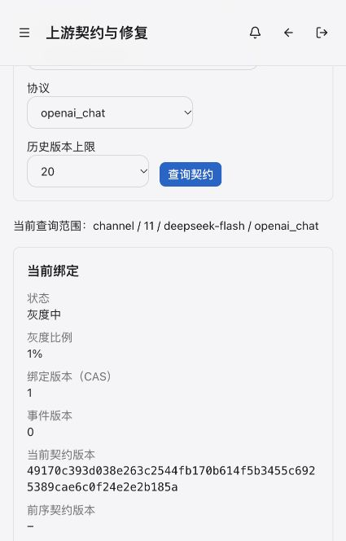

# 上游契约类型修复与渠道 11 生产试点

日期：2026-10-24（Asia/Shanghai）。维护者要求修复转换类型漂移、开启线上契约开关并发布，随后明确选择渠道 11 DeepSeek 试点，并单独授权向现有 builtin root 持久发布三项契约写权限。

## 已交付状态

- `rename/default` 必须声明类型，所有消费路径及 rename 目标在变更前检查；未知类型返回包含 revision、rule、path、expected/actual 的错误，字段值不进入错误。HTTP/SSE/WS 的类型拒绝回归断言上游调用为零。
- DeepSeek 独立 proof 只覆盖精确 `deepseek-flash/openai_chat` 的 HTTP JSON/SSE。原生结算 parser 与 Intent 不变；完整终结但计量非法的 SSE 可触发契约隔离，截断流不能形成成功证明。
- 五服务使用本机跨构建的 linux/amd64 镜像更新，先 Billing、Channel、Identity、Monitor，最后 Relay；统一回退点为 `rollback-20261024-140822`。最终五项 `/healthz` 均 200、重启 0、OOM false，三个契约 gate 均 true。[镜像与健康](evidence/upstream-contract-types-2026-10-24/production-deployment.json)。镜像标签的构建输入摘要为 `51c83086f4370c0ab9b1a666707efc7871ad883deb71c9a9e44f91c4316a3088`；后续仅修正 IAM 测试期望和发布记录，未再修改应用运行时代码。
- Identity 142 已由正式 migration runner 执行一次；三项 create/publish/quarantine 均 enabled/bound，固定审计 receipt 为 1。IAM 备份保留在生产 0700 目录，文件 0600；工具在数据库容器内通过既有 DBA Unix socket 连接运行。[迁移回执](evidence/upstream-contract-types-2026-10-24/permission142-production.txt)。

## 精确契约与正常管理链路

通过 [正式控制台](https://console.mengbin.top/admin/upstream-contracts) 的已登录管理员会话创建及发布，使用现有 Admin → IAM → Channel owner 路径。范围为 `channel / 11 / deepseek-flash / openai_chat`，endpoint 为 `/chat/completions`；仅对 `stream` 与 `stream_options.include_usage` 声明 boolean 拒绝规则。

不可变 revision：`49170c393d038e263c2544fb170b614f5b3455c6925389cae6c0f24e2e2b185a`。build 为 `finite-contract-runtime-2026-10-24.1`，proof pair 为 `deepseek-contract-proof-2026-10-24.1` / `deepseek-official-cache-proof-2026-10-24.1`。[文档](evidence/upstream-contract-types-2026-10-24/channel11-candidate.json)、[官方依据与 fixture 摘要](evidence/upstream-contract-types-2026-10-24/official-basis.json)。

JSON 与 SSE 两个 canary 分别于 **14:30:01 / 14:30:07 CST** 形成 owner 接受的成功证明；两次均为 7 个未缓存输入、2 个输出 token。14:31:10 CST 使用 fresh proof 与 CAS=0 发布 **1% gray**，得到 binding revision=1、incident revision=0。首次灰度未命中的请求继续既有未绑定路径；quarantine 仍阻断。

## 预算、证据与撤销

试点上限为四次推理、0.10 CNY，并设置 14:40:22 CST 的绝对到期时间；实际只运行两次，JSON/SSE 均 `contract_verified`，两个 owner probe 均 passed。原 native observation 仍为 unsupported，独立 proof 为 verified，Billing 持久保存两组 canary intent/terminal，未出现 user final。[试点结果](evidence/upstream-contract-types-2026-10-24/pilot-result.json)。

按归档官方周末空闲时段价格，两次费用估计合计 **0.000030 CNY**，按高峰价格计算也仅 **0.000060 CNY**；这两个数均为 tariff estimate，尚无本次逐请求供应商实扣凭据，实际扣费保持 unknown。

14:31:28 CST 撤销本次新增的两个付费目标，先重建 Monitor 停止调度，再重建 Relay 撤去准入，健康均 200。渠道 11 只保留原 bodyless inventory，`cost_upper_bound=0`。来源级 304 calls / 38,912 input / 364 output / unknown 4 的计数上限保留本轮四次试点额度，避免已记入历史的两次未知成本计数使库存任务被错误阻断；该配置没有任何渠道 11 付费推理目标。其他来源配置保持。[启动基线](evidence/upstream-contract-types-2026-10-24/pilot-start.json)、[撤销及最终快照](evidence/upstream-contract-types-2026-10-24/pilot-stop.json)。

试点前后 8 个钱包的聚合校验值相同，渠道 11 用户账本行数均为 201；本轮 canary 没有用户 final。未调整价格、收费 allowlist、结算算法或历史报告。

## 验证与后续边界

- 完整 `make verify` 通过：单元、race、架构、迁移、RBAC/IAM、生成类型、前端 lint、599 项测试、191 项关键覆盖与构建预算；关键覆盖与全量测试有重叠。[摘要](evidence/upstream-contract-types-2026-10-24/v0.36.5-verification.json)。八个直接相关后端包另以 `-race -count=1`、真实 HTTP/gRPC `internal/integration` 回归通过。
- Identity 142 在真实 SQLite、MySQL 8.4.11、PostgreSQL 16.15 上执行 33 个数据库场景，0 skip，覆盖 root-only、receipt 重放、既有 deny/窄授权及禁用/非法 root/resource；临时本地数据库容器已清理。[三方言证据](evidence/upstream-contract-types-2026-10-24/migration142-dialects.json)。
- 当前是 **1% 灰度**，没有全量晋级。业务完整样本为 0、失败 0；四次额度和两次成功 canary 均不能替代至少 30 分钟、100 个完整 verified attempt、零失败及新的 fresh proof。
- v0.36.4 tag 保持原样；正式权限迁移 142、测试期望修复与本次现场结果归入 [v0.36.5](../releases/release-v0.36.5.md)。标签后的 CI/Release 结果另在发布验证记录中保存。
